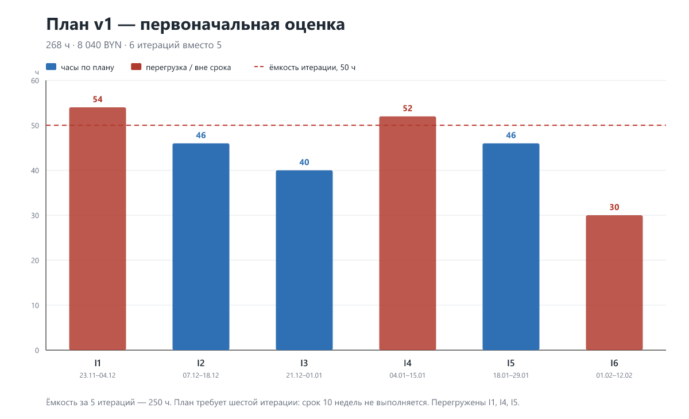
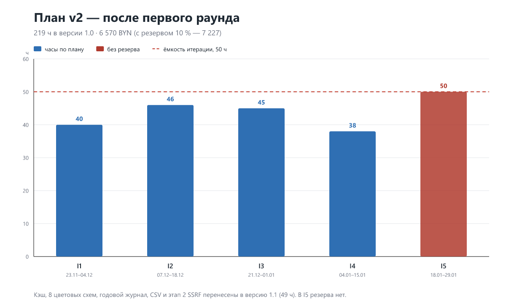
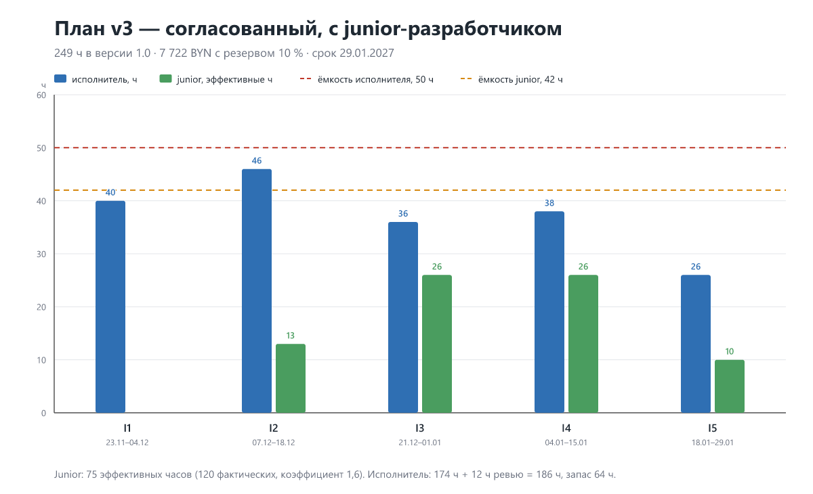

# План реализации ApiPulse по итерациям (v1 → v2 → v3)

В документе три версии плана: **v1** (первоначальная оценка), **v2** (после первого раунда обсуждения), **v3** (после второго раунда, с junior-разработчиком). Полный текст переписки — [`../correspondence/correspondence.md`](../correspondence/correspondence.md).

## 1. Исходные параметры и допущения

| Параметр | Значение |
|----------|----------|
| Срок версии 1.0 | 10 недель, 5 итераций по 2 недели (23.11.2026 — 29.01.2027) |
| Нагрузка исполнителя | 25 рабочих часов в неделю (50 ч за итерацию) |
| Ставка исполнителя | 30 BYN за час |
| Ставка junior-разработчика (v3) | 12 BYN за час |
| Производительность junior | коэффициент 1,6 (на задачу тратит в 1,6 раза больше часов) |
| Резерв на риски | 10 % от стоимости; в v1 не заложен, в v2 и v3 заложен |
| Планируемая загрузка итерации | не более 50 ч у исполнителя; у junior — не более 42 фактических часов |
| Релиз | 29.01.2027, не сдвигается (условие Заказчика) |

Итерации:

| Итерация | Даты |
|----------|------|
| I1 | 23.11 — 04.12.2026 |
| I2 | 07.12 — 18.12.2026 |
| I3 | 21.12.2026 — 01.01.2027 |
| I4 | 04.01 — 15.01.2027 |
| I5 | 18.01 — 29.01.2027 |

Приоритеты: 10 — Critical, 20 — High, 30 — Medium, 40 — Low, 50 — Optional. Полная шкала и системные требования — SDD, приложение D.

## 2. Работы и оценки (v1)

Оценка включает реализацию и модульные тесты. Источник — первоначальная оценка от 19.11.2026.

| Работа | Системное требование | Часы | Priority | Зависит от |
|--------|----------------------|-----:|---------:|------------|
| Каркас проекта, Docker, CI, миграции | SYS-NFR-016 | 16 | 20 | — |
| Регистрация, вход, JWT, хеширование паролей | SYS-FUNC-001 | 24 | 10 | каркас |
| Добавление и удаление API | SYS-FUNC-002 | 14 | 10 | вход |
| Планировщик проверок | SYS-FUNC-003 | 20 | 10 | API |
| Проба API | SYS-FUNC-004 | 12 | 10 | API |
| Хранение результатов проверок | SYS-FUNC-005 | 6 | 20 | проба |
| Шифрование ключа доступа | SYS-FUNC-006 | 10 | 20 | API |
| Определение статуса | SYS-FUNC-007 | 8 | 10 | проба |
| Панель статусов | SYS-FUNC-008 | 18 | 10 | статус |
| Уведомления: экран и почта | SYS-FUNC-009 | 22 | 10 | статус |
| Ручной ввод расходов | SYS-FUNC-010 | 10 | 20 | вход, API |
| Импорт CSV | SYS-FUNC-011 | 16 | 30 | расходы |
| Бюджет и предупреждения | SYS-FUNC-012 | 16 | 20 | расходы, уведомления |
| Журнал расходов (месяц, год, по дням) | SYS-FUNC-013, 013.1 | 14 | 30 | расходы |
| Защита от SSRF (этапы 1 и 2) | SYS-NFR-008, 008.1 | 20 | 20 | API |
| Кэш панели и журнала | SYS-NFR-003 | 12 | 30 | панель, журнал |
| Цветовые схемы (10 штук) | SYS-NFR-013, 013.1 | 10 | 30 | панель |
| Тесты, документация, нагрузочная проверка | SYS-NFR-011 | 20 | 40 | все |
| **Итого v1** | | **268** | | |

Стоимость v1: 268 × 30 = **8 040 BYN** (без резерва).

## 3. План v1 — 6 итераций, срок не выполняется

| Итерация | Состав | Часы |
|----------|--------|-----:|
| I1 | каркас (16), вход (24), API (14) | 54 |
| I2 | планировщик (20), проба (12), хранение (6), статус (8) | 46 |
| I3 | панель (18), уведомления (22) | 40 |
| I4 | шифрование (10), расходы (10), CSV (16), бюджет (16) | 52 |
| I5 | журнал (14), SSRF (20), кэш (12) | 46 |
| I6 | цветовые схемы (10), тесты и документация (20) | 30 |
| **Итого** | | **268** |

Ёмкость за 5 итераций — 250 ч, оценка — 268 ч. План требует **шестой итерации** (12 недель вместо 10), то есть в согласованный срок не выполняется. Кроме того, I1, I4 и I5 перегружены относительно 50 ч. Это исходная точка первого раунда переписки.

## 4. План v2 — после первого раунда (219 ч в версии 1.0)

Заказчик попросил уложиться в срок и убрать всё, что не нужно для целей BO-1 и BO-2. По итогам обсуждения в версию 1.1 перенесены:

| Работа | Было, ч | В 1.0, ч | В 1.1, ч | Почему |
|--------|--------:|---------:|---------:|--------|
| Кэш панели и журнала | 12 | 0 | 12 | при 100 пользователях нагрузка невелика |
| Цветовые схемы | 10 | 3 | 7 | в 1.0 достаточно светлой и тёмной |
| Журнал расходов | 14 | 8 | 6 | в 1.0 нужен месяц, год — позже |
| Импорт CSV | 16 | 0 | 16 | ручного ввода достаточно для старта |
| Защита от SSRF | 20 | 12 | 8 | этап 1 закрывает основной риск |
| **Итого** | **72** | **23** | **49** | |

Плановый объём v2: **1.0 — 219 ч, 1.1 — 49 ч** (всего 268 ч, объём не изменился — изменился порядок). Стоимость 1.0: 219 × 30 = 6 570 BYN; с резервом 10 % — **7 227 BYN**.

| Итерация | Состав | Часы |
|----------|--------|-----:|
| I1 | каркас (16), вход (24) | 40 |
| I2 | API (14), планировщик (20), проба (12) | 46 |
| I3 | хранение (6), статус (8), шифрование (10), SSRF этап 1 (12), часть тестов (9) | 45 |
| I4 | уведомления (22), бюджет (16) | 38 |
| I5 | панель (18), расходы (10), журнал за месяц (8), схемы (3), тесты (11) | 50 |
| **Итого** | | **219** |

Порядок выбран по зависимостям: вход → API → планировщик и проба → статус → панель и уведомления; расходы → бюджет; SSRF нужен до первой реальной пробы. В I5 нет резерва (50 из 50) — это одна из причин, по которым во втором раунде понадобился дополнительный ресурс.

## 5. Второй раунд: новые требования

После демо в конце I1 Заказчик добавил два требования:

| Новое требование | Работа | Priority | Часы |
|------------------|--------|---------:|-----:|
| REQ-FUNC-011 | Уведомления в Telegram: привязка по одноразовому коду, отправка после коммита, три попытки, отвязка | 30 | 14 |
| REQ-FUNC-006 (возврат) | Импорт расходов из CSV: разбор файла, отчёт по строкам, ограничение 5 МБ | 30 | 16 |
| **Итого нового** | | | **30** |

Объём версии 1.0 становится 219 + 30 = **249 ч**. Ёмкость 250 ч — план снова без резерва (99,6 % загрузки). С резервом 10 % требуется 274 ч, то есть на 24 ч больше ёмкости. Срок 29.01.2027 Заказчик сдвигать отказался.

## 6. Варианты решения (раунд 2)

| Вариант | Что это значит | Срок | Стоимость 1.0 с резервом 10 % |
|---------|----------------|------|------------------------------:|
| A | Сдвинуть релиз на одну итерацию (до 12.02.2027) | 12.02.2027 | 249 × 30 = 7 470 + 747 = **8 217** |
| B | Добавить junior-разработчика с I2 | 29.01.2027 | **7 722** |
| C | Не делать Telegram и CSV (вернуться к 219 ч) | 29.01.2027 | **7 227** |
| D | Junior только на часть задач, Telegram оставить исполнителю | 29.01.2027 | 7 700–7 900 |

Для справки: v2 стоила 7 227 BYN, v1 — 8 040 BYN без резерва.

Заказчик отклонил A (дата релиза зафиксирована) и C (Telegram и CSV обязательны), выбрал **B**.

## 7. Модель стоимости с junior (вариант B)

Кому что передаётся:

| Работа | Эффективные часы | Кому |
|--------|-----------------:|------|
| Панель статусов (SYS-FUNC-008) | 18 | junior |
| Ручной ввод расходов (SYS-FUNC-010) | 10 | junior |
| Импорт CSV (SYS-FUNC-011) | 16 | junior |
| Журнал за месяц (SYS-FUNC-013) | 8 | junior |
| Цветовые схемы (SYS-NFR-013) | 3 | junior |
| Тесты и документация (SYS-NFR-011) | 20 | junior |
| **Итого junior** | **75** | |
| Остальные работы 1.0 | 174 | исполнитель |
| Ревью и наставничество (16 % от 75) | 12 | исполнитель |
| **Итого исполнитель** | **186** | |

Фактические часы junior: 75 × 1,6 = **120 ч**. Загрузка: 120 ч за 10 недель = 12 ч в неделю; исполнитель — 186 ч = 18,6 ч в неделю. У исполнителя остаётся 64 ч запаса до 250 ч.

Смета:

| Статья | Часы | Ставка | Сумма |
|--------|-----:|-------:|------:|
| Исполнитель (174 ч работы + 12 ч ревью) | 186 | 30 | 5 580 |
| Junior (120 фактических часов) | 120 | 12 | 1 440 |
| Итого без резерва | | | 7 020 |
| Резерв 10 % | | | 702 |
| **Потолок стоимости** | | | **7 722** |

Это на 495 BYN (+6,8 %) больше v2 (7 227) — при том, что объём вырос на 30 ч (+13,7 %). Без junior тот же объём стоил бы 8 217 BYN, то есть junior экономит 495 BYN и, главное, сохраняет срок.

## 8. План v3 — согласованный (249 ч + junior)

| Итерация | Исполнитель | Junior (эффективные часы) | Запас исполнителя |
|----------|-------------|---------------------------|------------------:|
| I1 (23.11–04.12) | каркас, вход — 40 ч | — | 10 ч |
| I2 (07.12–18.12) | API, планировщик, проба — 46 ч | схемы (3), расходы (10) — 13 | 4 ч |
| I3 (21.12–01.01) | хранение, статус, шифрование, SSRF — 36 ч | панель (18), журнал (8) — 26 | 14 ч |
| I4 (04.01–15.01) | уведомления, бюджет — 38 ч | CSV (16), тесты (10) — 26 | 12 ч |
| I5 (18.01–29.01) | Telegram (14) + ревью (12) — 26 ч | тесты (10) — 10 | 24 ч |
| **Итого** | **186 ч** | **75 эффект. / 120 факт.** | |

Проверка зависимостей: панель (junior, I3) опирается на статус (исполнитель, начало I3); CSV (junior, I4) — на ручной ввод расходов (junior, I2); Telegram (исполнитель, I5) — на уведомления (исполнитель, I4); тесты идут в I4–I5. Критические задачи (вход, планировщик, проба, статус, уведомления, шифрование, SSRF, Telegram) остаются у исполнителя.

## 9. Что делать, если функция больше итерации

В этом проекте ни одна отдельная работа не превышает 50 ч (максимум — вход, 24 ч), поэтому дробить функции между итерациями не пришлось. Общее правило на будущее:

1. Функцию делят на вертикальные срезы, каждый из которых можно показать Заказчику: «вход без восстановления пароля», «панель без кэша», «CSV: только корректные строки, отчёт об ошибках — следующим срезом».
2. Первый срез делается тонким, но сквозным (UI → API → БД → тест), чтобы к концу итерации был рабочий сценарий, а не половина слоя.
3. Заказчику показывают план по срезам и дату первого демо, а не «функция займёт 3 итерации».
4. Если срез всё равно больше итерации, уменьшают объём (MoSCoW) или добавляют ресурс — как в варианте B этого плана.

## 10. Риски и запас

| Риск | Вероятность | Влияние | Меры |
|------|-------------|---------|------|
| Junior не успевает по панели или CSV | средняя | среднее | задачи junior не критичны; при отставании исполнитель забирает задачу в I4–I5 за счёт 36 ч запаса |
| Telegram меняет условия Bot API | низкая | низкое | канал изолирован адаптером `NotificationChannel`, замена не затрагивает ядро |
| Оценка SSRF занижена | средняя | высокое | этап 2 вынесен в 1.1; остаточный риск TOCTOU зафиксирован в ADR-0008 |
| Болезнь исполнителя | низкая | высокое | резерв 10 % и 64 ч запаса; junior может закрыть простые задачи |
| Новые пожелания Заказчика | высокая | высокое | правило: только через замену задачи равного объёма (зафиксировано в переписке, письмо 10) |

## 11. Сводка

| Версия плана | Объём 1.0 | Объём 1.1 | Срок | Стоимость 1.0 | Статус |
|--------------|----------:|----------:|------|--------------:|--------|
| v1 (19.11) | 268 | 0 | 12 недель | 8 040 (без резерва) | не выполняется по сроку |
| v2 (21.11) | 219 | 49 | 10 недель | 7 227 | согласован как база |
| v3 (25.11) | 249 | 33 | 10 недель | 7 722 | **согласован** |

Источник цифр: `../../sdd/project-sdd.md`, приложение D; переписка — `../correspondence/correspondence.md`.
