# Описание дизайна программного обеспечения

Для веб-приложения «ApiPulse»

Версия 0.5

Подготовил Ледник Я.Ю., гр. 450501

БГУИР, кафедра электронных вычислительных машин

2026-11-25

## Оглавление

* [1. Введение](#1-введение)
  * [1.1 Назначение документа](#11-назначение-документа)
  * [1.2 Область применения](#12-область-применения)
  * [1.3 Определения, акронимы и сокращения](#13-определения-акронимы-и-сокращения)
  * [1.4 Ссылки](#14-ссылки)
  * [1.5 Обзор документа](#15-обзор-документа)
* [2. Обзор дизайна](#2-обзор-дизайна)
  * [2.1 Задачи стейкхолдеров](#21-задачи-стейкхолдеров)
  * [2.2 Выбранные точки зрения](#22-выбранные-точки-зрения)
* [3. Проектные представления](#3-проектные-представления)
* [4. Решения](#4-решения)
* [5. Приложения](#5-приложения)

## История изменений

| Name | Date | Reason For Changes | Version |
|------|------|--------------------|---------|
| Ледник Я.Ю. | 2026-11-19 | Первая редакция по SRS v0.6: 19 представлений, ADR-0001 … ADR-0006, приложение D с системными требованиями и приоритетами | 0.1 |
| Ледник Я.Ю. | 2026-11-22 | По итогам первого раунда обсуждения с Заказчиком: изменены приоритеты, в версию 1.1 перенесены кэш, цветовые схемы, расширенный журнал, CSV-импорт и защита от DNS rebinding; добавлены ADR-0007 и ADR-0008; закрыты вопросы C1, C4, C5, C9, C10 | 0.2 |
| Ледник Я.Ю. | 2026-11-25 | По итогам второго раунда: CSV-импорт возвращён в версию 1.0, добавлены Telegram-уведомления (SYS-FUNC-014); обновлены представления 003, 008, 009, 019 и приложение D; по результатам внутреннего ревью уточнены представления 003, 007, 010 | 0.3 |
| Ледник Я.Ю. | 2026-11-25 | Сверка с репозиторием и ADR: раздел 4 приведён к формату шаблона со ссылками на файлы `adr/`; устранены расхождения между представлениями 010 и 015 (перезапуск), 008 и приложением D (длина пароля), 019 и SRS («нет ответа»); дополнены приложение B (B1, B3, закрытые вопросы C2, C3, C8) | 0.4 |
| Ледник Я.Ю. | 2026-11-25 | По итогам согласования с Заказчиком: SRS обновлён до v0.7 (добавлены REQ-FUNC-011, REQ-PERF-002, REQ-REL-001, REQ-AVAIL-001, снята пометка «предложено»); добавлен ADR-0009 (Telegram через long polling); приложение A пересчитано на 21 требование; добавлены ссылки на переписку и план v3, раздел 1.6 с итогами согласования; приложение D дополнено схемой распределения работ с junior-разработчиком | 0.5 |

---

## 1. Введение

Документ описывает проектное решение для веб-приложения «ApiPulse»: из каких частей оно состоит, как они взаимодействуют, какие данные хранятся и какие алгоритмы используются. Каждое представление связано с требованиями SRS, которые оно реализует, и с решениями из раздела 4.

### 1.1 Назначение документа

SDD отвечает на вопрос **как** будет построено то, что в SRS v0.7 определено как «что». Документ предназначен для разработчика (реализация по готовому проекту), тестировщика (проверяемые контракты и точки подмены внешних сервисов), Заказчика (понимание принятых решений и их влияния на сроки и стоимость) и преподавателя (трассируемость от требований к дизайну). Документ используется после согласования SRS и обновляется при каждом изменении требований. Связанные документы: SRS (`../srs/project-srs.md`), карточки требований (`../srs/project-req.md`), ADR (`adr/`), оценки и планы (`../docs/plans/`), переписка (`../docs/correspondence/`).

### 1.2 Область применения

**Система:** «ApiPulse», версия 1.0 — веб-приложение для мониторинга доступности внешних API и учёта расходов на них. Серверная часть написана на Java 21 (Spring Boot 3), данные хранятся в PostgreSQL, интерфейс — статические HTML и JavaScript, работающие в последних двух версиях Chrome, Firefox и Edge.

**Входит в SDD:** серверная часть, база данных, интерфейс, интеграции с почтовым сервисом и Telegram Bot API, развёртывание в контейнерах.

**Не входит в SDD:** визуальный дизайн экранов (макеты в SRS, приложение A), подробные тест-кейсы (раздел 4 SRS), оплата счетов поставщикам, автоматический сбор расходов у поставщиков, мобильное приложение (SRS 1.2).

Соответствие бизнес-целям SRS: BO-1 (быстро узнать о сбое) — представления 005, 009, 011, 015; BO-2 (все статусы на одном экране) — 008, 019; BO-3 (расходы не выходят за бюджет) — 007, 013; BO-4 (данные защищены) — 006, 008, 012, 017.

### 1.3 Определения, акронимы и сокращения

| Term | Definition |
|------|------------|
| ADR | Architecture Decision Record — протокол архитектурного решения |
| API | Application Programming Interface — интерфейс, через который одна программа обращается к другой |
| AES-GCM | Режим шифрования AES, который одновременно шифрует данные и проверяет, что их не подменили |
| bcrypt | Алгоритм необратимого хеширования паролей с солью и настраиваемой стоимостью |
| CSRF | Cross-Site Request Forgery — подделка запроса с чужого сайта от имени пользователя |
| DTO | Data Transfer Object — объект для передачи данных между слоями или по сети |
| JWT | JSON Web Token — подписанный токен, по которому сервер узнаёт пользователя |
| Проба (probe) | Один HTTPS-запрос к проверяемому API с оценкой результата |
| SDD | Software Design Description — документ, описывающий дизайн ПО |
| SRS | Software Requirements Specification — спецификация требований к ПО |
| SSRF | Server-Side Request Forgery — атака, при которой сервер заставляют обращаться к внутренним ресурсам |
| TTL | Time To Live — срок жизни записи кэша или токена |
| Виртуальный поток | Лёгкий поток Java 21, позволяющий иметь сотни одновременных ожиданий сети |
| Порт и адаптер | Интерфейс слоя Application (порт) и его реализация в Infrastructure (адаптер) |
| Неуспешная проба | Нет ответа за 10 секунд либо код 5xx (SRS, раздел 1.3) |
| Недоступный API | API, у которого три неуспешные пробы подряд |
| IPv4-mapped IPv6 | Запись адреса IPv4 в формате IPv6, например `::ffff:127.0.0.1`; обозначает тот же адрес, поэтому перед проверкой приводится к обычному IPv4 |
| Long polling | Способ получать события: приложение отправляет запрос, сервер держит его открытым до появления события или таймаута, затем запрос повторяется |
| SKIP LOCKED | Режим блокировки строк PostgreSQL: строки, уже занятые другим потоком, пропускаются, а не ожидаются |
| Sweeper | Фоновое задание-«уборщик», которое периодически подбирает недоделанную работу (например, неотправленные уведомления) |
| Семафор | Счётчик, ограничивающий число одновременно выполняемых задач (здесь не более 500 проб) |
| TOCTOU | Time Of Check To Time Of Use — ошибка, когда между проверкой (адрес безопасен) и использованием (соединение) данные успевают измениться |

### 1.4 Ссылки

| № | Источник | Тип | Расположение |
|---|----------|-----|--------------|
| 1 | SRS «ApiPulse», версия 0.7 | Нормативная | `../srs/project-srs.md` |
| 2 | Карточки требований | Справочная | `../srs/project-req.md` |
| 3 | ADR-0001 … ADR-0009 | Нормативная | `adr/` |
| 4 | История изменений SRS (включая v0.7) | Нормативная | `../srs/project-srs.md`, раздел «История изменений» |
| 5 | Оценки сроков и планы итераций v1–v3 | Справочная | `../docs/plans/plan.md` |
| 6 | Переписка с Заказчиком (раунды 1–2) | Справочная | `../docs/correspondence/correspondence.md` |
| 7 | Модели SysML v2 из SRS | Справочная | `../srs/img/` |
| 8 | Список лицензий библиотек | Справочная | `../docs/licenses.md` |

### 1.5 Обзор документа

Раздел 2 определяет стейкхолдеров и выбранные точки зрения. Раздел 3 содержит 19 проектных представлений с идентификаторами вида `001-context`; у каждого указаны точка зрения, представление (текст или диаграмма) и связанные требования SRS и решения. Раздел 4 перечисляет архитектурные решения со ссылками на полные ADR. Раздел 5: трассировка «требование → представление» (приложение A), замечания к SRS (приложение B), версия 1.1 (приложение C), системные требования с приоритетами 10–50 (приложение D). Диаграммы записаны в нотации Mermaid и отображаются на GitHub; для контекста, состояний и макетов используются изображения из `../srs/img`.

### 1.6 Итоги согласования с Заказчиком

Согласование заняло два раунда (19–25.11.2026, полный текст — `../docs/correspondence/correspondence.md`).

| Параметр | Итог |
|----------|------|
| Срок релиза версии 1.0 | 10 недель (5 итераций по 2 недели), не сдвигается |
| Объём версии 1.0 | 249 ч (21 требование SRS v0.7) |
| Объём версии 1.1 | 33 ч (кэш, 10 цветовых схем, годовой журнал, этап 2 защиты от SSRF) |
| Команда | Исполнитель (senior, 30 BYN/ч) + junior-разработчик с итерации 3 (12 BYN/ч, коэффициент 1,6, ревью 16 %) |
| Стоимость версии 1.0 | 7 722 BYN с резервом 10 % (вместо 8 217 BYN при работе без junior) |
| Резерв | 10 % от стоимости; в плане v1 резерва не было — добавлен после первого раунда |

План по итерациям и расчёт стоимости — `../docs/plans/plan.md`; распределение работ между исполнителем и junior — приложение D.4.

---

## 2. Обзор дизайна

ApiPulse построен как слоистое приложение: слой Web (REST-контроллеры, защита), слой Application (бизнес-логика и интерфейсы-порты) и слой Infrastructure (БД, HTTP-клиент, почта, Telegram, шифрование). Бизнес-логика не знает о конкретных технологиях: проверка API, отправка писем, шифрование и хранение скрыты за интерфейсами. Состояние API описывается явным конечным автоматом, а правила «ровно одно уведомление» гарантируются транзакциями и уникальными индексами БД. Схема слоёв соответствует справочной модели `../srs/img/03-architecture.sysml` (Presentation → Application ← Infrastructure), уточнённой при проектировании.

### 2.1 Задачи стейкхолдеров

| Стейкхолдер | Основные задачи | Точки зрения и представления |
|-------------|-----------------|------------------------------|
| Пользователь (разработчик, руководитель команды) | Быстро узнать о сбое; видеть все API на одном экране; не потерять данные | Взаимодействие (009, 010), Динамика состояний (014), UI (019) |
| Заказчик | Сроки, стоимость, понятность решений | Раздел 4, приложения A, C, D |
| Разработчик | Понятная структура, простая замена технологий | Композиция (002), Логическое (003), Зависимости (006), Паттерны (016) |
| Тестировщик | Проверяемость, возможность подменить внешние сервисы | Интерфейс (008), Алгоритм (011–013), Параллелизм (015) |
| Преподаватель | Трассируемость требований, обоснованность решений | Приложение A, раздел 4 |
| Сопровождающий / оператор | Развёртывание, журналы, резервные копии, секреты | Развёртывание (017), Ресурсы (018), Информация (007) |
| Специалист по безопасности | Защита паролей, ключей, изоляция данных, SSRF | 008, 012, ADR-0005, ADR-0006, ADR-0008 |

### 2.2 Выбранные точки зрения

Использованы все 15 точек зрения шаблона; для небольшого приложения часть из них описана кратко.

| Точка зрения | Что адресует | Представления |
|--------------|--------------|---------------|
| Контекст | Границы системы, внешние системы | 001 |
| Композиция | Слои и основные компоненты | 002 |
| Логическое | Доменные типы и интерфейсы | 003 |
| Физическое | Оборудование и сеть | 004 |
| Структура | Внутреннее устройство конвейера проверки | 005 |
| Зависимости | Зависимости между пакетами и библиотеками | 006 |
| Информация | Схема БД, ограничения, объёмы | 007 |
| Интерфейс | REST API, внутренние порты | 008, 019 |
| Взаимодействие | Порядок сообщений, пути отказов | 009, 010 |
| Алгоритм | Статус API, проверка адресов, бюджет | 011, 012, 013 |
| Динамика состояний | Состояния наблюдаемого API | 014 |
| Параллелизм | Планировщик, блокировки, транзакции | 015 |
| Паттерны | Применённые паттерны проектирования | 016 |
| Развёртывание | Контейнеры, переменные окружения | 017 |
| Ресурсы | Нагрузка, хранение, ограничения | 018 |

---

## 3. Проектные представления

Идентификаторы вида `ННН-название` используются для ссылок из других разделов. В каждом представлении указаны реализуемые требования SRS (REQ-…) и связанные решения (ADR-…).

### 001-context — Контекст системы

- **ID**: 001-context
- **Title**: Контекст приложения ApiPulse
- **Viewpoint**: Контекст
- **Representation**:

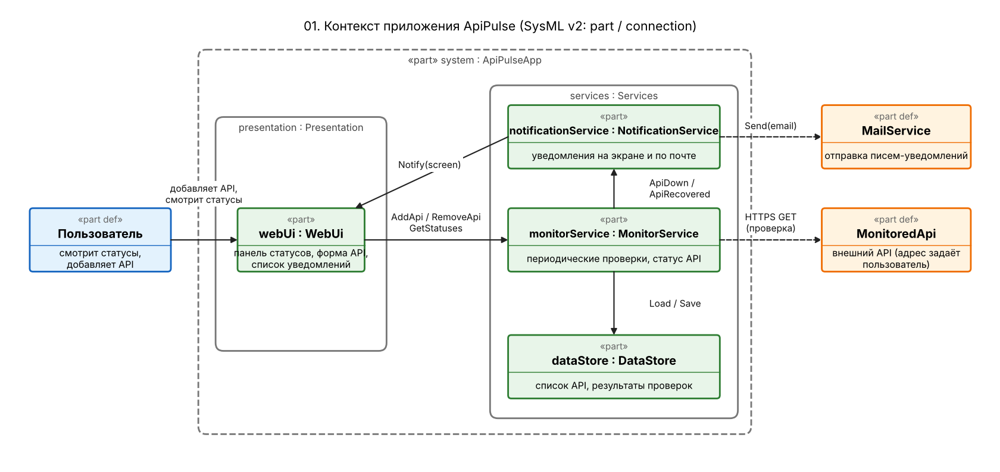

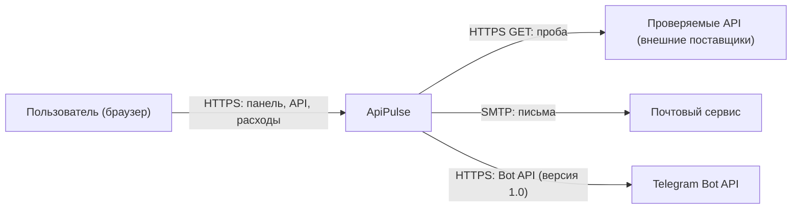

Приложение предоставляет пользователю регистрацию и вход, добавление и удаление API, автоматические проверки, панель статусов, уведомления на экране, по почте и в Telegram, ввод и импорт расходов, бюджет с предупреждениями и журнал расходов. Проверяемые API не изменяются.

- **More Information**: SRS 2.1, 3.1.3; REQ-FUNC-001 … REQ-FUNC-004, REQ-FUNC-011; схема из `../srs/img/01-context.sysml`.

### 002-composition — Состав и слои приложения

- **ID**: 002-composition
- **Title**: Композиция приложения из слоёв и компонентов
- **Viewpoint**: Композиция
- **Representation**:

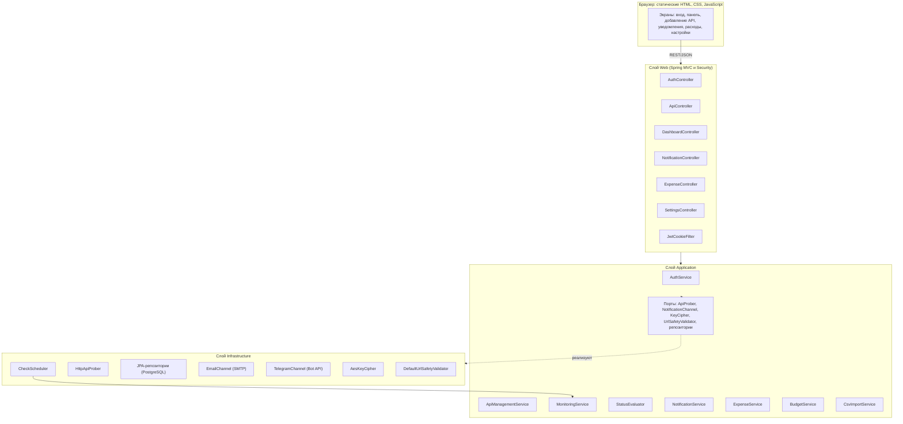

Слои соответствуют справочной схеме `../srs/img/03-architecture.sysml`. Функциональное деление: учётные записи (`AuthService`), список API (`ApiManagementService`), мониторинг (`MonitoringService`, `StatusEvaluator`, `CheckScheduler`), уведомления (`NotificationService` и каналы), расходы и бюджет (`ExpenseService`, `BudgetService`, `CsvImportService`). Рантайм-деление: один процесс приложения и одна БД.

- **More Information**: REQ-SEC-001, REQ-FUNC-001 … REQ-FUNC-011; решения ADR-0001, ADR-0003.

### 003-logical — Доменные типы и интерфейсы

- **ID**: 003-logical
- **Title**: Логическая модель: доменные типы и порты
- **Viewpoint**: Логическое представление
- **Representation**:

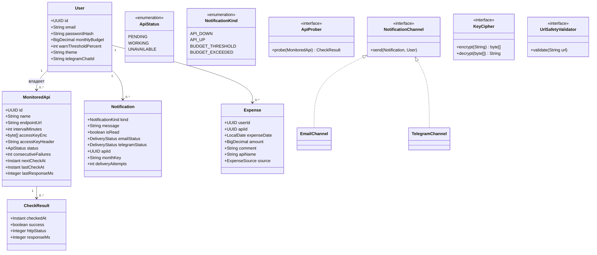

Отображаемый статус («работает» или «недоступен») вычисляется по `status` и `consecutiveFailures` (представление 011). Деньги хранятся типом `BigDecimal` с двумя знаками. Названия API копируются в расход (`apiName`), поэтому журнал не теряет названия после удаления API (C3). Новые поля Telegram добавлены в версии 0.3. Поля `userId`, `apiId`, `monthKey` и `deliveryAttempts` приведены в соответствие со схемой БД (представление 007).

- **More Information**: REQ-FUNC-001 … REQ-FUNC-011, REQ-SEC-001; решения ADR-0006.

### 004-physical — Физическое окружение

- **ID**: 004-physical
- **Title**: Физическое окружение приложения
- **Viewpoint**: Физическое представление
- **Representation**: Сервер приложения: один виртуальный или физический сервер с Linux (минимум 2 vCPU, 2 ГБ ОЗУ, 20 ГБ диска) с доступом в Интернет по HTTPS (порт 443) и SMTP. Пользователь работает с компьютером или планшетом с браузером Chrome, Firefox или Edge (две последние версии). Специального оборудования нет.
- **More Information**: SRS 2.3, 3.1.2; приложение D (SYS-NFR-012, SYS-NFR-014).

### 005-structure — Конвейер проверки API

- **ID**: 005-structure
- **Title**: Внутреннее устройство конвейера проверки
- **Viewpoint**: Структура
- **Representation**:

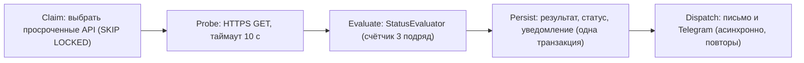

Блоки `Claim`, `Persist` работают с БД, `Probe` — с внешней сетью, `Evaluate` — чистая логика без обращения к БД (легко тестируется), `Dispatch` отправляет сообщения отдельно от транзакции, чтобы медленная почта не задерживала проверки.

- **More Information**: REQ-FUNC-002 … REQ-FUNC-004; решение ADR-0003.

### 006-dependency — Зависимости между пакетами

- **ID**: 006-dependency
- **Title**: Граф зависимостей пакетов и библиотек
- **Viewpoint**: Зависимости
- **Representation**:

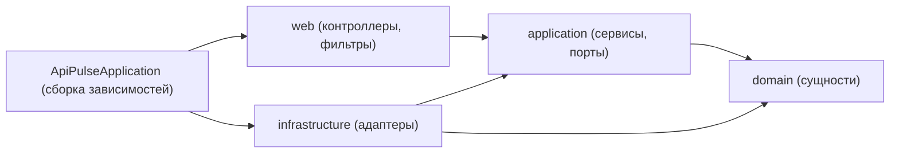

Правило: пакеты `web` и `application` не ссылаются на `infrastructure`; это проверяется архитектурным тестом (ArchUnit). Основные библиотеки: Spring Boot 3 (Web, Security, Data JPA, Mail, Validation), PostgreSQL JDBC, Flyway, jjwt (JWT), Jakarta Mail, JUnit 5, Mockito, Testcontainers; в версии 1.1 добавляются Caffeine и Apache HttpClient 5. Лицензии библиотек перечисляются в `../docs/licenses.md`.

- **More Information**: ADR-0001; SYS-NFR-011.

### 007-information — Постоянные данные

- **ID**: 007-information
- **Title**: Схема базы данных
- **Viewpoint**: Информация
- **Representation**:

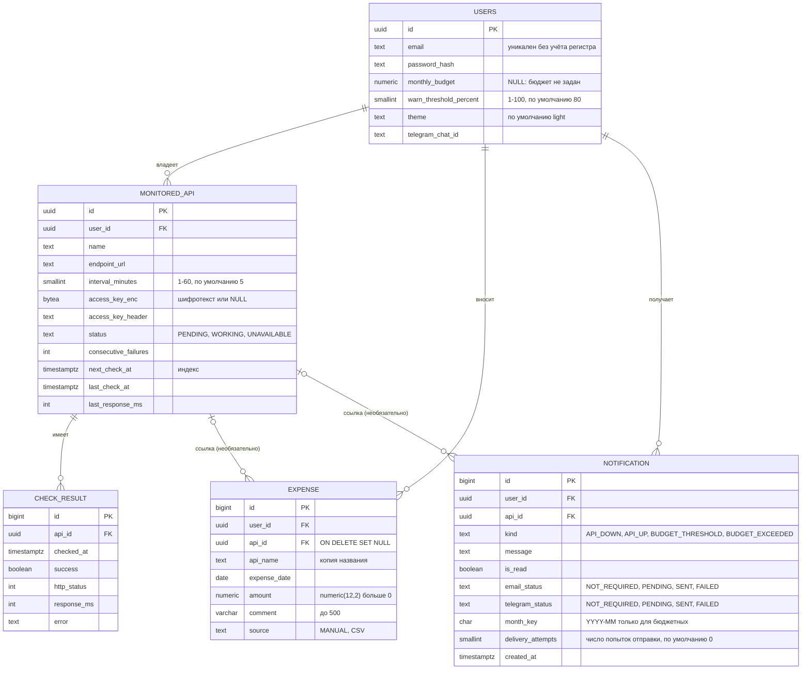

Правила и ограничения:

1. `users`: уникальный индекс по `lower(email)`; пароль только в виде bcrypt-хеша.
2. `monitored_api`: индекс `(next_check_at)` для выбора просроченных; при удалении API каскадно удаляются `check_result`, а в `expense.api_id` ставится `NULL` (название остаётся в `api_name`).
3. `check_result`: индекс `(api_id, checked_at)`; хранится 7 дней, устаревшие записи удаляет ежедневное задание.
4. `notification`: частичный уникальный индекс `(user_id, kind, month_key) WHERE kind IN ('BUDGET_THRESHOLD','BUDGET_EXCEEDED')` гарантирует не более одного уведомления каждого вида в месяц (REQ-FUNC-008); запись делается `INSERT … ON CONFLICT DO NOTHING`.
5. `expense`: сумма больше нуля, два знака; индекс `(user_id, expense_date)` для журнала.
6. Все выборки включают `user_id` из токена (изоляция, REQ-SEC-001); запрос чужого объекта даёт 404.
7. Единая валюта приложения — BYN (C4); валюта в БД не хранится. Календарный месяц и «текущая дата» считаются по часовому поясу `Europe/Minsk` (C5).
8. `notification.api_id`: `ON DELETE SET NULL`; уведомление остаётся в списке, потому что название API уже есть в тексте `message`.
9. `users`: частичный уникальный индекс по `telegram_chat_id` (где значение не `NULL`): один чат Telegram привязан только к одной учётной записи.
10. `notification.delivery_attempts` увеличивается при каждой попытке отправки; после 3 попыток статус канала становится `FAILED`.

- **More Information**: REQ-FUNC-001, REQ-FUNC-004 … REQ-FUNC-011, REQ-REL-001, REQ-SEC-001, REQ-SEC-003; решения ADR-0002, ADR-0006.

### 008-interface — Контракты интерфейсов

- **ID**: 008-interface
- **Title**: REST API и внутренние порты
- **Viewpoint**: Интерфейс
- **Representation**:

Все запросы идут по HTTPS, данные в формате JSON, аутентификация по cookie `apipulse_token` (ADR-0005). Запросы, меняющие данные, содержат заголовок `X-Requested-With: ApiPulse`.

| Метод и путь | Назначение | Основные ответы | Требования |
|--------------|-----------|-----------------|------------|
| `POST /api/auth/register` | Регистрация: `email`, `password`, `passwordConfirm`, `rememberDevice` | 201 + cookie; 400 с полем ошибки; 409 если адрес занят | REQ-FUNC-010 |
| `POST /api/auth/login` | Вход: `email`, `password`, `rememberDevice` | 200 + cookie; 401 «Неверная почта или пароль» | REQ-FUNC-010, REQ-SEC-004 |
| `POST /api/auth/logout` | Выход: очистка cookie | 204 | REQ-SEC-004 |
| `GET /api/apis` | Список API пользователя | 200 | REQ-FUNC-001 |
| `POST /api/apis` | Добавить API: `name`, `endpointUrl`, `intervalMinutes`, `accessKey?`, `accessKeyHeader?` | 201; 400 `{field, message}` | REQ-FUNC-001, REQ-SEC-003, REQ-SEC-005 |
| `DELETE /api/apis/{id}` | Удалить API | 204; 404 | REQ-FUNC-001 |
| `GET /api/dashboard` | Статусы, время проверки, время ответа, число непрочитанных уведомлений | 200 | REQ-FUNC-003 |
| `GET /api/notifications` | Список уведомлений (фильтр `unread`) | 200 | REQ-FUNC-004, REQ-FUNC-008 |
| `POST /api/notifications/{id}/read` | Отметить прочитанным | 204; 404 | REQ-FUNC-004 |
| `POST /api/expenses` | Добавить расход: `apiId`, `date`, `amount`, `comment?` | 201; 400 | REQ-FUNC-005 |
| `POST /api/expenses/import` | Импорт CSV (multipart) | 200 `{imported, rejected:[{line, reason}]}`; 413 при размере более 5 МБ | REQ-FUNC-006 |
| `GET /api/expenses?month=YYYY-MM` | Журнал расходов за месяц (в версии 1.1 также `year=YYYY` и разбивка по дням) | 200 | REQ-FUNC-009 |
| `GET/PUT /api/settings/budget` | Месячный бюджет и порог | 200; 400 | REQ-FUNC-007 |
| `PUT /api/settings/theme` | Цветовая схема (версия 1.1: не менее 10) | 204 | REQ-INT-001 |
| `POST /api/telegram/link-token` | Получить одноразовый код привязки | 200 `{token, botName}` | REQ-FUNC-011 |
| `DELETE /api/telegram` | Отвязать Telegram | 204 | REQ-FUNC-011 |

Формат ошибок: `{"field": "name", "message": "Введите название API"}`; для 401 и 404 тело пустое. Ограничения ввода: пароль не короче 8 символов и не длиннее 72 байт UTF-8 (предел bcrypt), название API до 100 символов, адрес до 2048 символов, комментарий до 500 символов.

Внутренние порты (слой Application):

```java
public interface ApiProber { CheckResult probe(MonitoredApi api); }
public interface NotificationChannel { void send(Notification n, User owner); }
public interface KeyCipher { byte[] encrypt(String plain); String decrypt(byte[] cipher); }
public interface UrlSafetyValidator { void validate(String url) throws UnsafeUrlException; }
```

Контракт `ApiProber.probe`: выполняет `GET` с таймаутом 10 секунд (время ответа считается до получения заголовков), не следует редиректам, передаёт ключ доступа в заголовке пользователя, никогда не бросает исключение: любой сбой (таймаут, DNS, соединение, адрес не прошёл проверку) возвращается как неуспешная проба.

Telegram (версия 0.3): бот вызывается методом `sendMessage` по HTTPS на фиксированный адрес `api.telegram.org`; привязка выполняется командой `/start <token>`, после которой `chat_id` сохраняется у пользователя.

- **More Information**: REQ-FUNC-001 … REQ-FUNC-011, REQ-SEC-001 … REQ-SEC-005; решения ADR-0004, ADR-0005, ADR-0006.

### 009-interaction-check — Проверка API и уведомление

- **ID**: 009-interaction-check
- **Title**: Диаграмма последовательности: проверка API и рассылка уведомлений
- **Viewpoint**: Взаимодействие
- **Representation**:

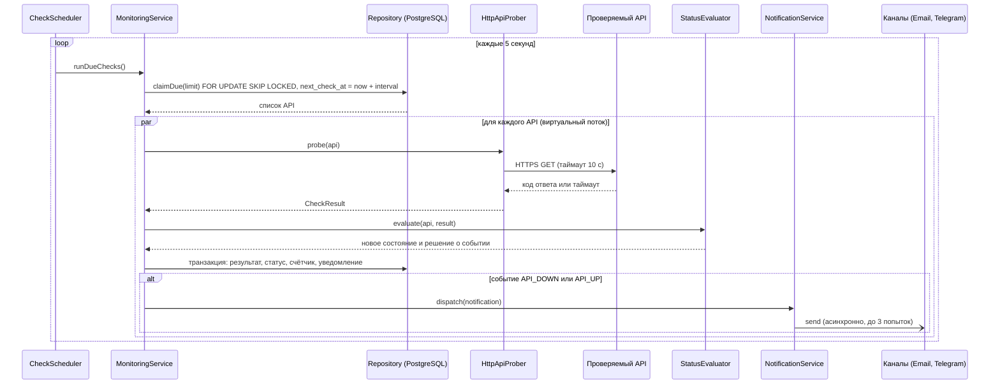

Диаграмма показывает основной сценарий. Если во время пробы API удалён, обновление строки не затрагивает ни одной записи, и результат отбрасывается. Отправка писем и сообщений Telegram выполняется после фиксации транзакции и не влияет на следующую проверку.

- **More Information**: REQ-FUNC-002, REQ-FUNC-003, REQ-FUNC-004, REQ-FUNC-011; решения ADR-0003.

### 010-interaction-failures — Пути отказа

- **ID**: 010-interaction-failures
- **Title**: Поведение при сбоях
- **Viewpoint**: Взаимодействие
- **Representation**:

| Ситуация | Поведение | Требования |
|----------|-----------|------------|
| Проверяемый API не отвечает 10 секунд или вернул 5xx | Неуспешная проба: счётчик растёт | REQ-FUNC-002 |
| Ответ 2xx, 3xx, 4xx | Успешная проба; редиректы не выполняются; неверный ключ (401, 403) сбоем не считается (C2) | REQ-FUNC-002 |
| DNS-имя API не разрешается или разрешается во внутренний адрес | Неуспешная проба (запрос не отправляется), запись в журнал | REQ-SEC-005 |
| Почтовый сервис недоступен | Три попытки (сразу, через 30 с и 5 мин); уведомление остаётся на экране, статус `FAILED` | REQ-FUNC-004 |
| Telegram API недоступен | То же, что для почты; почта и экран не затрагиваются | REQ-FUNC-011 |
| Приложение перезапущено во время проверки | `next_check_at`, счётчик и уведомления сохранены; после запуска просроченные проверки выполняются сразу; проба, взятая в момент остановки, считается пропущенной (расписание уже сдвинуто, см. 015), следующая выполняется в свой срок; повторных уведомлений нет | REQ-REL-001 |
| API удалён во время пробы | Результат отбрасывается без ошибки | REQ-FUNC-001 |
| Недоступна БД | Контроллеры отвечают 503; планировщик пропускает такт | REQ-AVAIL-001 |
| CSV с ошибочными строками | Корректные строки импортируются, отчёт показывает номер строки и причину | REQ-FUNC-006 |
| Чужой идентификатор в запросе | 404 без раскрытия существования | REQ-SEC-001 |
| Нет токена или он недействителен | 401 | REQ-SEC-001, REQ-SEC-004 |
| Приложение остановлено после коммита, но до отправки письма или Telegram | Уведомление осталось в статусе `PENDING`; фоновое задание (sweeper) каждые 30 с повторно отправляет такие уведомления, всего не более 3 попыток | REQ-REL-001, REQ-FUNC-004 |
| Адрес API внутренний или недопустимый при добавлении | 400 `{field: "endpointUrl", message}` | REQ-SEC-005 |
| Имя заголовка ключа доступа недопустимо (пробелы, служебный заголовок) | 400 `{field: "accessKeyHeader", message}` | REQ-SEC-003, REQ-FUNC-001 |
| Код привязки Telegram просрочен, уже использован или потерян при перезапуске | Бот отвечает «код недействителен»; пользователь запрашивает новый | REQ-FUNC-011 |

- **More Information**: представления 011, 014, 015; SYS-FUNC-007, SYS-NFR-010.

### 011-algorithm-status — Определение статуса API

- **ID**: 011-algorithm-status
- **Title**: Алгоритм `StatusEvaluator`: правило «три неуспешные проверки подряд»
- **Viewpoint**: Алгоритм
- **Representation**:

`StatusEvaluator` — чистая функция: она получает состояние API и результат одной пробы, а возвращает новое состояние и событие (или «нет события»). Она не обращается к БД, часам и сети, поэтому её легко проверять обычными модульными тестами.

```text
evaluate(api, result):
    if result.success:
        wasDown = (api.status == UNAVAILABLE)
        api.consecutiveFailures = 0
        api.status = WORKING
        event = wasDown ? API_UP : NONE
    else:
        api.consecutiveFailures = api.consecutiveFailures + 1
        if api.consecutiveFailures >= 3:
            event = (api.status != UNAVAILABLE) ? API_DOWN : NONE
            api.status = UNAVAILABLE
        else:
            api.status = WORKING          // 1 или 2 неудачи подряд: на панели «работает»
            event = NONE
    api.lastCheckAt    = result.checkedAt
    api.lastResponseMs = result.responseMs   // null: на панели «нет ответа»
    return (api, event)
```

Таблица решений (она же основа параметризованного теста):

| Статус до | Неудач подряд до | Результат пробы | Неудач подряд после | Статус после | Событие |
|-----------|------------------|-----------------|---------------------|--------------|---------|
| PENDING | 0 | успех | 0 | WORKING | нет |
| PENDING | 0 | неудача | 1 | WORKING | нет |
| WORKING | 0 | успех | 0 | WORKING | нет |
| WORKING | 0 | неудача | 1 | WORKING | нет |
| WORKING | 1 | неудача | 2 | WORKING | нет |
| WORKING | 2 | неудача | 3 | UNAVAILABLE | **API_DOWN** |
| WORKING | 1 или 2 | успех | 0 | WORKING | нет |
| UNAVAILABLE | 3 и более | неудача | растёт | UNAVAILABLE | нет (повтора нет) |
| UNAVAILABLE | 3 и более | успех | 0 | WORKING | **API_UP** |

Свойства алгоритма:

1. Инвариант: `consecutiveFailures >= 3` тогда и только тогда, когда `status = UNAVAILABLE`.
2. На одну серию неудач приходится ровно одно событие `API_DOWN`; новое событие возможно только после возврата в `WORKING`, то есть это и есть «новый сбой» из REQ-FUNC-004.
3. Состояние `PENDING` хранится до первой проверки. На панели оно показывается как «ожидает первой проверки», потому что SRS (рисунок 3) выделяет это состояние отдельно.
4. Сложность — O(1) по времени и памяти; число событий за проверку не больше одного.

- **More Information**: REQ-FUNC-002, REQ-FUNC-003, REQ-FUNC-004; SYS-FUNC-007; диаграмма состояний 014-state-dynamics; решение ADR-0003.

### 012-algorithm-url-safety — Проверка адреса и имени заголовка

- **ID**: 012-algorithm-url-safety
- **Title**: Алгоритм `UrlSafetyValidator` и проверка имени заголовка ключа доступа
- **Viewpoint**: Алгоритм
- **Representation**:

Проверка выполняется в двух местах одним и тем же кодом: при добавлении API (`POST /api/apis`) и перед каждой пробой (`HttpApiProber`). Это закрывает сценарий, когда имя API сначала указывало на публичный сервер, а потом начало указывать на внутренний.

```text
validate(url):
    1. если длина url > 2048           -> отклонить
    2. разобрать url как URI           -> при ошибке отклонить
    3. если схема не http и не https   -> отклонить
    4. если у URI есть userinfo («user:pass@host») или нет host -> отклонить
    5. addresses = resolveAll(host)    // тот же результат DNS, который затем использует клиент
       если addresses пуст или DNS не ответил -> отклонить
    6. для каждого address из addresses:
           address = normalize(address)     // IPv4-mapped IPv6 (::ffff:a.b.c.d) -> IPv4
           если address входит в запрещённый диапазон -> отклонить
    7. принять
```

Правило «отклонить, если хотя бы один адрес непубличный» важно: злоумышленник может завести DNS-имя с двумя адресами (публичным и внутренним), и клиент выберет любой из них.

Запрещённые диапазоны. Первые двенадцать записей взяты из ADR-0008, остальные добавлены при проектировании алгоритма:

| Диапазон | Что это |
|----------|---------|
| `0.0.0.0/8` | «этот хост», включая `0.0.0.0` |
| `10.0.0.0/8`, `172.16.0.0/12`, `192.168.0.0/16` | частные сети IPv4 |
| `100.64.0.0/10` | общая адресация операторов (CGNAT) |
| `127.0.0.0/8`, `::1` | localhost |
| `169.254.0.0/16`, `fe80::/10` | link-local, включая метаданные облака `169.254.169.254` |
| `224.0.0.0/4`, `ff00::/8` | multicast |
| `fc00::/7` | unique local IPv6 |
| `192.0.0.0/24`, `192.0.2.0/24`, `198.51.100.0/24`, `203.0.113.0/24` | служебные и документационные диапазоны IPv4 |
| `198.18.0.0/15` | стенды тестирования сетей |
| `240.0.0.0/4` | зарезервировано |
| `::/128`, `2001:db8::/32` | неопределённый адрес и документационный диапазон IPv6 |

Дополнительно к списку проверяются встроенные признаки `InetAddress` (`isAnyLocalAddress`, `isLoopbackAddress`, `isLinkLocalAddress`, `isSiteLocalAddress`, `isMulticastAddress`): список и методы дополняют друг друга.

Имя заголовка ключа доступа (`accessKeyHeader`) проверяется при добавлении API, потому что пользователь вводит его сам:

```text
validateHeaderName(name):
    если name не соответствует ^[A-Za-z0-9-]{1,64}$ -> отклонить   // только символы «токена» HTTP
    если lower(name) входит в запрещённый набор     -> отклонить
```

Запрещённый набор: `host`, `content-length`, `transfer-encoding`, `connection`, `upgrade`, `te`, `trailer`, `expect`, `keep-alive`, `cookie`, `proxy-authorization`, а также любое имя, начинающееся с `proxy-`. Без этого пользователь мог бы подменить служебные заголовки запроса. Если имя не указано, используется `Authorization`.

Поведение при отказе:

| Где | Реакция |
|-----|---------|
| Добавление API | 400, `{"field": "endpointUrl", "message": "Адрес недопустим: ..."}`; для заголовка `{"field": "accessKeyHeader", ...}` |
| Перед пробой | запрос не отправляется, проба неуспешна, причина пишется в `check_result.error` |

Этап 2 (версия 1.1, ADR-0008): соединение устанавливается с IP-адресом, уже прошедшим проверку; для этого подключается Apache HttpClient 5 с собственным `DnsResolver`, и второго обращения к DNS между проверкой и соединением нет. До версии 1.1 остаётся риск TOCTOU (Time Of Check To Time Of Use): DNS-сервер злоумышленника может ответить по-разному на проверку и на соединение.

Проверка тестами (REQ-SEC-005): `localhost`, `127.0.0.1`, `10.0.0.1`, `172.16.0.1`, `192.168.1.1`, `169.254.169.254`, `[::1]`, `[fc00::1]`, `0.0.0.0`, `[::ffff:127.0.0.1]`, `http://user@example.com/`, имя с двумя адресами (публичный и внутренний), схема `ftp://`; публичный адрес принимается.

- **More Information**: REQ-SEC-005, REQ-SEC-003, REQ-FUNC-001, REQ-FUNC-002; SYS-NFR-008; решения ADR-0006, ADR-0008.

### 013-algorithm-budget — Проверка бюджета

- **ID**: 013-algorithm-budget
- **Title**: Алгоритм `BudgetService`: пороги и повторные уведомления
- **Viewpoint**: Алгоритм
- **Representation**:

Проверка запускается после добавления расхода, после импорта CSV (один раз на весь файл, а не на каждую строку) и после изменения бюджета или порога.

```text
checkBudget(user):
    если user.monthlyBudget == NULL: выйти
    month = текущий месяц по часовому поясу Europe/Minsk, ключ «YYYY-MM»
    sum   = SUM(expense.amount) за этот месяц для user         // только текущий месяц
    если sum * 100 >= monthlyBudget * warnThresholdPercent:
        вставить Notification(BUDGET_THRESHOLD, month_key=month)  ON CONFLICT DO NOTHING
    если sum > monthlyBudget:
        вставить Notification(BUDGET_EXCEEDED, month_key=month)   ON CONFLICT DO NOTHING
```

Сравнение выполняется в `BigDecimal` без округления. Правило «не более одного уведомления каждого вида за месяц» обеспечивает частичный уникальный индекс из представления 007 (`INSERT … ON CONFLICT DO NOTHING`): даже если два запроса придут одновременно, вторая вставка ничего не сделает.

Пример при бюджете 1000,00 и пороге 80 %:

| Действие | Сумма за месяц | Результат |
|----------|----------------|-----------|
| Расход 500,00 | 500,00 | уведомлений нет |
| Расход 300,00 | 800,00 | порог достигнут (условие «не меньше») → `BUDGET_THRESHOLD` |
| Расход 150,00 | 950,00 | уведомлений нет (порог уже был) |
| Расход 50,00 | 1000,00 | уведомлений нет: «превышает» значит строго больше |
| Расход 10,00 | 1010,00 | `BUDGET_EXCEEDED` |
| Расход 100,00 | 1110,00 | уведомлений нет (превышение уже было) |

Особые случаи:

- Если импорт CSV за один раз пересёк и порог, и бюджет, создаются оба уведомления.
- При пороге 100 % оба события различаются: порог срабатывает при `sum = budget`, превышение только при `sum > budget`.
- Расход с датой прошлого месяца в сумму текущего месяца не входит и уведомление не создаёт.
- После изменения бюджета или порога сумма пересчитывается, но ранее созданные уведомления не удаляются (REQ-FUNC-007); новое уведомление того же вида в том же месяце не создаётся из-за уникального индекса. Это следствие правила «не более одного за месяц».
- Бюджетные уведомления показываются только на экране: в Telegram и на почту не отправляются (REQ-FUNC-008, REQ-FUNC-011).

- **More Information**: REQ-FUNC-005 … REQ-FUNC-008; SYS-FUNC-012; решение ADR-0002; представление 007-information.

### 014-state-dynamics — Состояния API и доставки уведомлений

- **ID**: 014-state-dynamics
- **Title**: Состояния наблюдаемого API и статуса доставки уведомления
- **Viewpoint**: Динамика состояний
- **Representation**:

Состояния из SRS (рисунок 3, `../srs/img/04-states.png`) в хранилище записываются так: `pending` → `PENDING`; `working`, `failed1`, `failed2` → `WORKING` с числом `consecutiveFailures` 0, 1 или 2; `unavailable` → `UNAVAILABLE`; `removed` — строка удалена из БД.

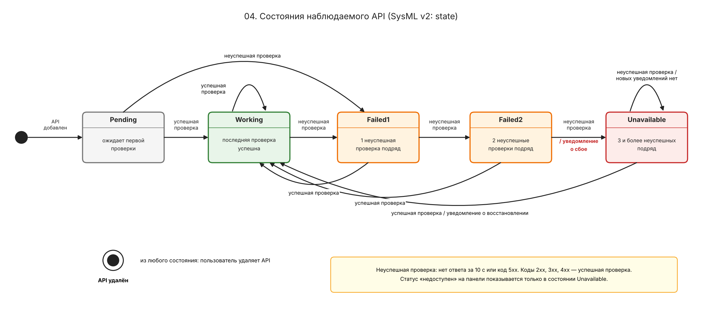

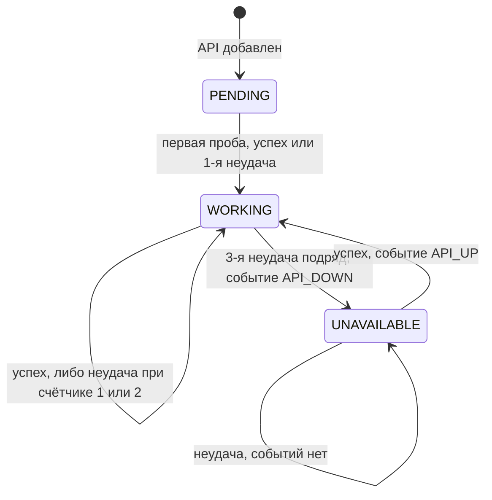

Удаление API (`DELETE /api/apis/{id}`) возможно из любого состояния и завершает наблюдение.

Состояния доставки одного уведомления по одному каналу (отдельно для почты и Telegram):

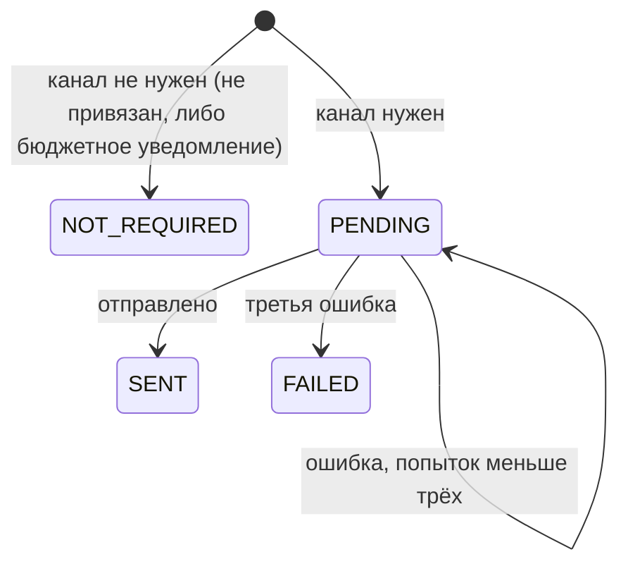

Уведомление на экране от статуса доставки не зависит: оно создаётся в той же транзакции, что и событие, и остаётся в списке при любом исходе отправки.

- **More Information**: REQ-FUNC-002 … REQ-FUNC-004, REQ-FUNC-011, REQ-REL-001; SYS-FUNC-007, SYS-FUNC-009; представление 011-algorithm-status.

### 015-concurrency — Параллелизм и синхронизация

- **ID**: 015-concurrency
- **Title**: Потоки, блокировки и транзакции
- **Viewpoint**: Параллелизм
- **Representation**:

| Задача | Как выполняется | Частота | Замечание |
|--------|-----------------|---------|-----------|
| Опрос расписания (`CheckScheduler`) | один поток, `@Scheduled(fixedDelay = 5 с)` | каждые 5 с | выбирает до 500 просроченных API за такт |
| Проба одного API | виртуальный поток Java 21 | по `next_check_at` | одновременно не более 500 проб (семафор) |
| Отправка почты и Telegram | отдельный исполнитель на виртуальных потоках | после коммита транзакции | до 3 попыток: сразу, через 30 с, через 5 мин |
| «Уборщик» уведомлений (sweeper) | один фоновый поток | каждые 30 с | подбирает уведомления в `PENDING`, которые не были отправлены (например, после падения приложения) |
| Приём команд Telegram | один фоновый виртуальный поток, long polling `getUpdates` с ожиданием 30 с | непрерывно | обрабатывает `/start <код>` |
| Очистка старых результатов | ежедневное задание в 03:00 `Europe/Minsk` | раз в сутки | удаляет `check_result` старше 7 дней пакетами |

Выбор просроченных проверок и сдвиг расписания выполняются одним запросом, чтобы два потока или два экземпляра приложения не взяли один API дважды:

```sql
WITH due AS (
    SELECT id FROM monitored_api
    WHERE next_check_at <= now()
    ORDER BY next_check_at
    LIMIT 500
    FOR UPDATE SKIP LOCKED
)
UPDATE monitored_api a
SET next_check_at = now() + a.interval_minutes * interval '1 minute'
FROM due
WHERE a.id = due.id
RETURNING a.*;
```

`FOR UPDATE SKIP LOCKED` означает: «заблокируй найденные строки для себя, а строки, уже заблокированные другим, молча пропусти». Поэтому конкурирующие потоки делят работу, не ожидая друг друга.

Запись результата пробы — одна транзакция (уровень `READ COMMITTED`) в фиксированном порядке: обновление `monitored_api` (статус, счётчик, время и длительность ответа), вставка `check_result`, вставка `notification`. Если строки API уже нет (его удалили во время пробы), обновление затрагивает 0 строк, и вся транзакция откатывается без ошибки.

Гонки и способы защиты:

| Ситуация | Защита |
|----------|--------|
| Два экземпляра берут один API | `SKIP LOCKED` в запросе выбора |
| API удалён во время пробы | обновление 0 строк → откат, результат отбрасывается |
| Два одновременных расхода пересекают порог | частичный уникальный индекс + `ON CONFLICT DO NOTHING` |
| Приложение остановлено после выбора, но до записи результата | расписание уже сдвинуто, проба пропущена до следующего срока; счётчик и уведомления не дублируются |
| Приложение остановлено после коммита, но до отправки письма | уведомление в `PENDING`; sweeper отправит его после запуска |
| Проверок больше, чем может выполниться | избыточные пробы ждут на семафоре; задержка видна метрикой «опоздание старта» |
| Привязка Telegram: код использован дважды | одноразовый код удаляется из памяти при первом успешном `/start`; повторный вызов получает отказ |

Код привязки Telegram хранится в памяти приложения (`ConcurrentHashMap`, срок жизни 15 минут). После перезапуска приложения незавершённые привязки теряются, и пользователь просто запрашивает новый код.

- **More Information**: REQ-FUNC-002, REQ-FUNC-004, REQ-FUNC-008, REQ-FUNC-011, REQ-PERF-002, REQ-REL-001, REQ-SEC-005; решения ADR-0002, ADR-0003, ADR-0008.

### 016-patterns — Применённые паттерны

- **ID**: 016-patterns
- **Title**: Паттерны проектирования и архитектурные стили
- **Viewpoint**: Паттерны
- **Representation**:

| Паттерн | Где применён | Зачем |
|---------|--------------|-------|
| Слоистая архитектура и «порты и адаптеры» | Web → Application ← Infrastructure; порты `ApiProber`, `NotificationChannel`, `KeyCipher`, `UrlSafetyValidator` | бизнес-логику можно проверять без сети и БД, технологии заменяются |
| Стратегия (Strategy) | `NotificationChannel` с реализациями `EmailChannel` и `TelegramChannel` | новый канал уведомлений добавляется без изменения `NotificationService` |
| Репозиторий (Repository) | интерфейсы доступа к `User`, `MonitoredApi`, `Expense`, `Notification` | отделяет бизнес-логику от SQL |
| Чистая функция / конечный автомат | `StatusEvaluator` (представление 011) | правило «три подряд» проверяется таблицей без БД |
| Конкурирующие потребители | `claimDue` с `SKIP LOCKED` | несколько потоков или экземпляров делят очередь проверок без дублей |
| Ограничение конкурентности (семафор) | не более 500 одновременных проб | защита сервера от перегрузки |
| Отложенная отправка (упрощённый outbox) | запись уведомления в транзакции, отправка после коммита, sweeper | уведомление не теряется при сбое между этими шагами |
| Идемпотентная вставка | `INSERT … ON CONFLICT DO NOTHING` | «не более одного уведомления за месяц» без гонок |
| DTO | запросы и ответы REST | границы контрактов, защита от случайной утечки полей (например, хеша пароля) |
| Cache-aside (версия 1.1) | Caffeine для панели и журнала | снижение нагрузки; решение ADR-0007 |

- **More Information**: ADR-0001, ADR-0003, ADR-0007; представления 002, 003, 006.

### 017-deployment — Развёртывание

- **ID**: 017-deployment
- **Title**: Контейнеры, переменные окружения и сборка
- **Viewpoint**: Развёртывание
- **Representation**:

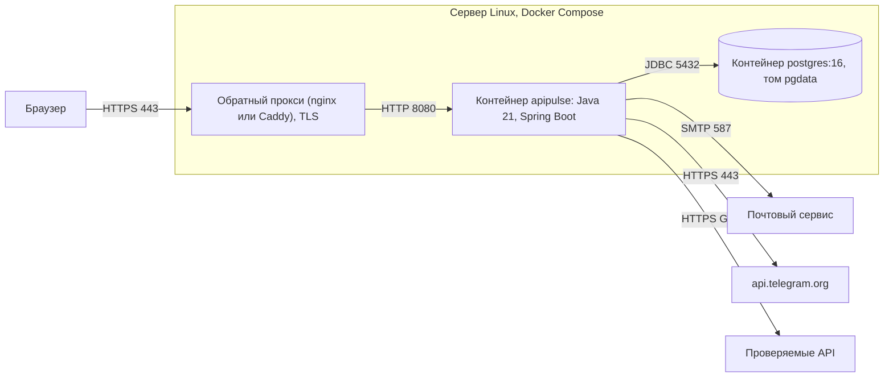

Порт БД наружу не публикуется. Обратный прокси завершает TLS; приложение за ним получает заголовки `X-Forwarded-*`, чтобы cookie получали флаг `Secure` (ADR-0005). Для Telegram нужны только исходящие соединения: публичный адрес для webhook не требуется, поскольку используется long polling.

Настройки передаются переменными окружения (секреты не хранятся в образе и репозитории):

| Переменная | Назначение | Требования |
|------------|-----------|------------|
| `APIPULSE_MASTER_KEY` | мастер-ключ AES-256 для ключей доступа к API (ADR-0006) | REQ-SEC-003 |
| `APIPULSE_JWT_SECRET` | секрет подписи JWT, не короче 256 бит (ADR-0005) | REQ-SEC-004 |
| `DB_URL`, `DB_USER`, `DB_PASSWORD` | подключение к PostgreSQL | ADR-0002 |
| `SMTP_HOST`, `SMTP_PORT`, `SMTP_USER`, `SMTP_PASSWORD`, `MAIL_FROM` | почтовый сервис | REQ-FUNC-004 |
| `TELEGRAM_BOT_TOKEN`, `TELEGRAM_BOT_NAME` | бот для уведомлений | REQ-FUNC-011 |
| `COOKIE_SECURE` | `true` по умолчанию; `false` только для локальной разработки | ADR-0005 |
| `APP_TIMEZONE` | `Europe/Minsk` по умолчанию | C5 |

Сборка и проверка (CI):

1. Сборка Maven, модульные тесты и архитектурный тест ArchUnit.
2. Интеграционные тесты на PostgreSQL через Testcontainers; миграции Flyway применяются к пустой БД.
3. Сборка образа и запуск `docker compose` для сквозной проверки (вход, добавление API, получение уведомления на тестовом эндпоинте).

Эксплуатация: ежедневная резервная копия БД (`pg_dump`); мастер-ключ хранится отдельно от копии БД, потеря ключа делает сохранённые ключи доступа нечитаемыми (ADR-0006). При недоступной БД приложение отвечает 503 и продолжает работу после её восстановления без перезапуска (REQ-AVAIL-001).

- **More Information**: SYS-NFR-012, SYS-NFR-014, SYS-NFR-016; REQ-SEC-003, REQ-SEC-004; решения ADR-0002, ADR-0005, ADR-0006.

### 018-resources — Ресурсы и нагрузка

- **ID**: 018-resources
- **Title**: Оценка нагрузки, памяти и объёма хранения
- **Viewpoint**: Ресурсы
- **Representation**:

Исходные данные: до 2000 проверяемых API (ADR-0003), до 100 пользователей (ADR-0007), худший случай — интервал 1 минута у всех API.

| Ресурс | Расчёт | Вывод |
|--------|--------|-------|
| Проб в секунду | 2000 / 60 ≈ 33 | около 165 API на каждый такт планировщика (5 с); лимит выборки 500 достаточен |
| Одновременные пробы | 33 в секунду × таймаут 10 с ≈ 330 в худшем случае | семафор 500 с запасом; виртуальные потоки дешёвы |
| Память приложения | 300–500 МБ (ADR-0001) | размер кучи ограничить `-Xmx512m`; с PostgreSQL и системой хватает 2 ГБ ОЗУ |
| Процессор | 2 vCPU | основная работа — ожидание сети, а не вычисления |
| Подключения к БД | пул HikariCP, 20 подключений | планировщик и запись результатов не должны занимать пул целиком |
| Результаты проверок | худший случай: 2000 × 1440 за сутки = 2,88 млн строк; за 7 дней ≈ 20 млн строк по ≈100 Б вместе с индексом ≈ 2 ГБ | диска 20 ГБ достаточно; ежедневная очистка пакетами |
| Расходы | порядка десятков строк на пользователя в месяц | на объём почти не влияют |
| Запросы панели | 100 пользователей × 6 запросов в минуту = 600 в минуту ≈ 10 в секунду | нагрузка небольшая; кэш (версия 1.1) уменьшит её |
| Telegram | ограничения Bot API (порядка 1 сообщения в секунду в один чат и до 30 в секунду всего) | очередь отправки с ограничением до 25 сообщений в секунду |
| Почта | три попытки, паузы 30 с и 5 мин | не блокирует проверки (отправка вне транзакции) |

Метрики для контроля (пишутся в журнал и доступны через `/actuator/health` и метрики): число проб в секунду, задержка старта пробы относительно `next_check_at` (цель: 99-й процентиль не больше 10 с, REQ-PERF-002), число уведомлений в `PENDING`, занятость пула БД.

- **More Information**: REQ-PERF-001, REQ-PERF-002, REQ-FUNC-011; SYS-NFR-001, SYS-NFR-012; решения ADR-0001, ADR-0003, ADR-0007.

### 019-ui-screens — Экраны интерфейса

- **ID**: 019-ui-screens
- **Title**: Экраны, навигация и связь с REST API
- **Viewpoint**: Интерфейс
- **Representation**:

Интерфейс — статические HTML, CSS и JavaScript (ES2022, `fetch`) без сборщика (ADR-0004). Макеты экранов — `../srs/img/mockup-dashboard.png` и `../srs/img/mockup-add-api.png` (SRS, приложение A); остальные экраны строятся по тем же правилам оформления.

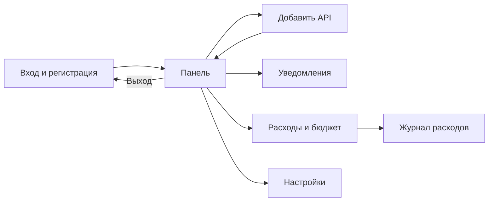

| Экран | Содержание | Запросы к API | Требования |
|-------|-----------|---------------|------------|
| Вход и регистрация | поля почты и пароля (при регистрации дважды), флажок «запомнить устройство» (по умолчанию выключен), общее сообщение «Неверная почта или пароль» | `/api/auth/register`, `/api/auth/login` | REQ-FUNC-010, REQ-SEC-004 |
| Панель | таблица API: название, адрес, статус, время ответа («нет ответа», если ответ не получен), время проверки; баннер о сбое; счётчик непрочитанных на вкладке «Уведомления»; кнопки «+ Добавить API» и «Удалить» | `GET /api/dashboard`, `DELETE /api/apis/{id}` | REQ-FUNC-003, REQ-FUNC-001 |
| Добавить API | поля «Название», «Адрес эндпоинта», «Интервал проверки, мин» (по умолчанию 5), необязательные «Ключ доступа» и «Имя заголовка»; сообщение об ошибке показывается у неверно заполненного поля | `POST /api/apis` | REQ-FUNC-001, REQ-FUNC-002, REQ-SEC-003, REQ-SEC-005 |
| Уведомления | список о сбоях, восстановлении и бюджете, кнопка «Прочитано» | `GET /api/notifications`, `POST /api/notifications/{id}/read` | REQ-FUNC-004, REQ-FUNC-008 |
| Расходы и бюджет | форма ручного ввода, загрузка CSV с отчётом об отклонённых строках, поля бюджета и порога | `POST /api/expenses`, `POST /api/expenses/import`, `GET/PUT /api/settings/budget` | REQ-FUNC-005, REQ-FUNC-006, REQ-FUNC-007 |
| Журнал расходов | выбор месяца, расходы с итогом (в версии 1.1: выбор года и разбивка по дням) | `GET /api/expenses?month=YYYY-MM` | REQ-FUNC-009 |
| Настройки | выбор цветовой схемы (версия 1.0: светлая и тёмная; версия 1.1: не менее 10); привязка и отвязка Telegram: кнопка показывает одноразовый код и имя бота | `PUT /api/settings/theme`, `POST /api/telegram/link-token`, `DELETE /api/telegram` | REQ-INT-001, REQ-FUNC-011 |

Поведение интерфейса:

1. Панель опрашивает `GET /api/dashboard` раз в 10 секунд, пока вкладка видна; в скрытой вкладке (событие `visibilitychange`) — раз в 60 секунд (ADR-0004). Страница не перезагружается.
2. Если счётчик непрочитанных уведомлений вырос, интерфейс запрашивает `GET /api/notifications?unread=true` и показывает баннер для непрочитанного уведомления о сбое.
3. Ошибка с полем `{field, message}` отображается рядом с этим полем; ответы 401 переводят на экран входа.
4. Все изменяющие запросы содержат заголовок `X-Requested-With: ApiPulse` (ADR-0005).
5. Цвета задаются переменными CSS и атрибутом `data-theme` на корневом элементе; выбранная схема сохраняется в учётной записи и применяется сразу, без перезагрузки.
6. Ключ доступа после сохранения не показывается: интерфейс получает только признак «ключ задан».

- **More Information**: REQ-FUNC-001 … REQ-FUNC-011, REQ-INT-001; решения ADR-0004, ADR-0005; SRS, приложение A.

---

## 4. Решения

Полные записи находятся в папке `adr/` (формат MADR); ниже каждое решение приведено в формате шаблона SDD со ссылкой на файл.

- **ID**: 0001-spring-boot-java-backend
- **Title**: Spring Boot 3 на Java 21 для серверной части
- **Context**: SRS (раздел 2.3) требует Java на сервере. Нужны аутентификация, планировщик проверок, почта и работа с БД, а на проект отведено 10 недель по 25 часов, поэтому готовые модули важнее собственного кода.
- **Options**: Spring Boot 3 (Java 21); Quarkus; Javalin или другой лёгкий каркас с ручной сборкой.
- **Outcome**: Выбран вариант «Spring Boot 3 (Java 21)», потому что стартеры Web, Security, Data JPA, Mail и Validation закрывают почти все потребности, а виртуальные потоки Java 21 подходят для сотен параллельных проб.
- **More Information**: [`adr/ADR-0001-spring-boot-java-backend.md`](../adr/ADR-0001-spring-boot-java-backend.md); ADR-0001; представления 002, 006.

---

- **ID**: 0002-postgresql-database
- **Title**: PostgreSQL 16 как основная база данных
- **Context**: Часть правил должна гарантироваться самой базой: не более одного уведомления о бюджете в месяц, уникальность почты без учёта регистра, точные денежные суммы, безопасная выборка проверок без дублей.
- **Options**: PostgreSQL 16; MySQL 8; встраиваемая база (H2 или SQLite).
- **Outcome**: Выбран вариант «PostgreSQL 16», потому что он поддерживает частичные уникальные индексы, `INSERT … ON CONFLICT DO NOTHING`, `FOR UPDATE SKIP LOCKED` и тип `numeric(12,2)`; схема создаётся миграциями Flyway.
- **More Information**: [`adr/ADR-0002-postgresql-database.md`](../adr/ADR-0002-postgresql-database.md); ADR-0002; представления 007, 015, 017.

---

- **ID**: 0003-db-backed-check-scheduler
- **Title**: Планирование проверок по полю `next_check_at` в БД
- **Context**: У каждого API свой интервал от 1 до 60 минут, допуск запуска ±10 секунд (REQ-FUNC-002); расписание, счётчики и уведомления нельзя терять при перезапуске; нагрузка до 2000 API, около 33 проб в секунду.
- **Options**: Планировщик на основе БД; Quartz Scheduler; таймер в памяти на каждый API; брокер сообщений.
- **Outcome**: Выбран вариант «Планировщик на основе БД», потому что расписание хранится вместе с данными и переживает перезапуск, а `SKIP LOCKED` не даёт двум потокам или экземплярам взять один API дважды.
- **More Information**: [`adr/ADR-0003-db-backed-check-scheduler.md`](../adr/ADR-0003-db-backed-check-scheduler.md); ADR-0003; представления 005, 009, 015, 018.

---

- **ID**: 0004-dashboard-polling
- **Title**: Обновление панели опросом раз в 10 секунд
- **Context**: Новый результат проверки должен появляться на панели без перезагрузки не позднее чем через 30 секунд (REQ-FUNC-003); интерфейс работает в последних двух версиях Chrome, Firefox и Edge, времени на интерфейс мало.
- **Options**: Опрос REST API раз в 10 секунд из статических HTML и JavaScript; Server-Sent Events; WebSocket.
- **Outcome**: Выбран вариант «Опрос раз в 10 секунд», потому что он проще остальных, надёжно работает через прокси и даёт задержку около 10 секунд (до 20 вместе с кэшем версии 1.1) при требовании 30.
- **More Information**: [`adr/ADR-0004-dashboard-polling.md`](../adr/ADR-0004-dashboard-polling.md); ADR-0004; представления 008, 019.

---

- **ID**: 0005-jwt-in-httponly-cookie
- **Title**: JWT в cookie с флагами HttpOnly, Secure и SameSite=Strict
- **Context**: REQ-SEC-004 требует подписанный JWT со сроком 60 минут или 30 дней. Украденный токен даёт доступ к чужим API, расходам и ключам, поэтому важно, где браузер его хранит.
- **Options**: JWT в cookie `HttpOnly; Secure; SameSite=Strict`; JWT в `localStorage` и заголовок `Authorization: Bearer`; серверные сессии.
- **Outcome**: Выбран вариант «JWT в cookie с флагами HttpOnly, Secure, SameSite=Strict», потому что скрипты страницы не могут прочитать такую cookie; от CSRF дополнительно защищает заголовок `X-Requested-With`.
- **More Information**: [`adr/ADR-0005-jwt-in-httponly-cookie.md`](../adr/ADR-0005-jwt-in-httponly-cookie.md); ADR-0005; представления 008, 019.

---

- **ID**: 0006-aes-gcm-access-key-encryption
- **Title**: Шифрование ключей доступа к API алгоритмом AES-256-GCM
- **Context**: Ключ доступа нужно расшифровывать при каждой проверке, поэтому необратимый хеш не подходит; ключ шифрования должен храниться отдельно от данных (REQ-SEC-003).
- **Options**: AES-256-GCM в приложении с мастер-ключом в переменной окружения; шифрование в БД (`pgcrypto`); внешнее хранилище секретов (Vault или KMS).
- **Outcome**: Выбран вариант «AES-256-GCM в приложении», потому что режим GCM шифрует и проверяет целостность, мастер-ключ не попадает в БД, а внешние сервисы не нужны.
- **More Information**: [`adr/ADR-0006-aes-gcm-access-key-encryption.md`](../adr/ADR-0006-aes-gcm-access-key-encryption.md); ADR-0006; представления 007, 008, 017.

---

- **ID**: 0007-in-process-caffeine-cache
- **Title**: Кэширование панели и журнала библиотекой Caffeine
- **Context**: REQ-PERF-001 требует кэш панели (TTL не более 15 секунд) и журнала (не более 60 секунд), разделённый по пользователям. По итогам обсуждения с Заказчиком реализация перенесена в версию 1.1.
- **Options**: Caffeine (кэш в памяти процесса); Redis; без кэша.
- **Outcome**: Выбран вариант «Caffeine», потому что приложение работает одним процессом, отдельный сервер не нужен, а библиотека поддерживает TTL и принудительное удаление записей. Реализация в версии 1.1.
- **More Information**: [`adr/ADR-0007-in-process-caffeine-cache.md`](../adr/ADR-0007-in-process-caffeine-cache.md); ADR-0007; представления 008, 018.

---

- **ID**: 0008-ssrf-url-validation
- **Title**: Поэтапная защита от SSRF
- **Context**: Сервер сам отправляет запросы на адреса, которые вводит пользователь; без проверки можно обратиться к `localhost` или метаданным облака (REQ-SEC-005). Полная защита от DNS rebinding стоит около 8 часов сверх базовой.
- **Options**: Два этапа (проверка при добавлении и перед каждой пробой, затем привязка соединения к проверенному IP); только проверка при добавлении; внешний исходящий прокси.
- **Outcome**: Выбран вариант «Поэтапная проверка», потому что основной риск закрыт уже в версии 1.0 за 12 часов, а привязка к проверенному IP добавляется в версии 1.1 за 8 часов; остаточный риск TOCTOU записан.
- **More Information**: [`adr/ADR-0008-ssrf-url-validation.md`](../adr/ADR-0008-ssrf-url-validation.md); ADR-0008; представления 012, 015.

---

- **ID**: 0009-telegram-notifications
- **Title**: Уведомления в Telegram через Bot API с long polling
- **Context**: Во втором раунде Заказчик добавил обязательное требование REQ-FUNC-011: сообщения о сбое и восстановлении должны приходить в Telegram. Нужен канал, который работает без публичного адреса приложения и не усложняет развёртывание; бюджет и срок фиксированы.
- **Options**: Telegram Bot API с long polling; webhook с публичным HTTPS-адресом; только почта и экран; сторонний сервис уведомлений.
- **Outcome**: Выбран вариант «Bot API с long polling», потому что приложению достаточно исходящих соединений, отдельный сервер и сертификат не нужны, а привязка чата выполняется одноразовым кодом `/start <код>`; отправка идёт после коммита уведомления, при сбое — три попытки, неотправленные подбирает sweeper.
- **More Information**: [`adr/ADR-0009-telegram-notifications.md`](../adr/ADR-0009-telegram-notifications.md); ADR-0009; представления 001, 003, 008, 009, 010, 014, 015, 017, 018, 019.

---

Решения меньшего масштаба, для которых отдельный ADR не нужен (обратимые и локальные):

| № | Решение | Обоснование |
|---|---------|-------------|
| M-1 | Слои и «порты и адаптеры» (представления 002, 006, 016) | следствие ADR-0001; проверяется ArchUnit |
| M-2 | Telegram: код привязки одноразовый и хранится в памяти 15 минут | детали канала — ADR-0009; потеря кода при перезапуске безвредна |
| M-3 | Валюта BYN, часовой пояс `Europe/Minsk` (вопросы C4, C5) | закрыты вместе с Заказчиком |
| M-4 | Пароль: bcrypt со стоимостью 12, длина до 72 байт UTF-8 | предел bcrypt; проверка длины по байтам |
| M-5 | Результаты проверок хранятся 7 дней | панели нужна только последняя проба; история не требуется |
| M-6 | Уведомления отправляются после коммита, незавершённые подбирает sweeper | исключает потерю при сбое и не задерживает проверки |

---

## 5. Приложения

### Приложение A. Трассировка «требование → проектное решение»

Для каждого требования указаны представления SDD, решения ADR, системные требования (приложение D) и тест-кейс из SRS. Все 21 требование входят в SRS v0.7.

| Требование | Представления | ADR | Системные требования | Тест |
|------------|---------------|-----|----------------------|------|
| REQ-FUNC-001 | 002, 003, 007, 008, 010, 012, 019 | ADR-0006, ADR-0008 | SYS-FUNC-002, SYS-FUNC-006 | TC-FUNC-001 |
| REQ-FUNC-002 | 005, 009, 010, 011, 015, 018 | ADR-0003 | SYS-FUNC-003, SYS-FUNC-004, SYS-FUNC-005 | TC-FUNC-002 |
| REQ-FUNC-003 | 008, 011, 014, 019 | ADR-0004, ADR-0007 | SYS-FUNC-007, SYS-FUNC-008, SYS-NFR-002 | TC-FUNC-003 |
| REQ-FUNC-004 | 005, 009, 010, 011, 014, 015 | ADR-0003 | SYS-FUNC-007, SYS-FUNC-009 | TC-FUNC-004 |
| REQ-FUNC-005 | 003, 007, 008, 013, 019 | ADR-0002 | SYS-FUNC-010 | TC-FUNC-005 |
| REQ-FUNC-006 | 008, 010, 013, 019 | ADR-0002 | SYS-FUNC-011 | TC-FUNC-006 |
| REQ-FUNC-007 | 007, 008, 013, 019 | ADR-0002 | SYS-FUNC-012 | TC-FUNC-007 |
| REQ-FUNC-008 | 007, 013, 015 | ADR-0002 | SYS-FUNC-012 | TC-FUNC-008 |
| REQ-FUNC-009 | 007, 008, 019 | ADR-0002 | SYS-FUNC-013, SYS-FUNC-013.1 | TC-FUNC-009 |
| REQ-FUNC-010 | 003, 007, 008, 019 | ADR-0005 | SYS-FUNC-001 | TC-FUNC-010 |
| REQ-FUNC-011 | 001, 003, 008, 009, 010, 014, 015, 017, 018, 019 | ADR-0009 | SYS-FUNC-014 | TC-FUNC-011 |
| REQ-INT-001 | 008, 019 | ADR-0004 | SYS-NFR-013, SYS-NFR-013.1 | TC-INT-001 |
| REQ-PERF-001 | 008, 018 | ADR-0007 | SYS-NFR-003 | TC-PERF-001 |
| REQ-PERF-002 | 005, 015, 018 | ADR-0003 | SYS-NFR-001 | TC-PERF-002 |
| REQ-SEC-001 | 006, 007, 008 | ADR-0002 | SYS-NFR-004 | TC-SEC-001 |
| REQ-SEC-002 | 003, 008 | ADR-0005 | SYS-NFR-005 | TC-SEC-002 |
| REQ-SEC-003 | 007, 008, 012, 017 | ADR-0006 | SYS-FUNC-006, SYS-NFR-007 | TC-SEC-003 |
| REQ-SEC-004 | 008, 019 | ADR-0005 | SYS-NFR-006 | TC-SEC-004 |
| REQ-SEC-005 | 010, 012, 015 | ADR-0008 | SYS-NFR-008, SYS-NFR-008.1 | TC-SEC-005 |
| REQ-REL-001 | 009, 010, 014, 015 | ADR-0003 | SYS-NFR-010 | TC-REL-001 |
| REQ-AVAIL-001 | 010, 017 | ADR-0002 | SYS-NFR-010 | TC-AVAIL-001 |

Покрытие: все 21 требование SRS v0.7 имеют хотя бы одно представление, системное требование и тест-кейс; требований без проектного решения нет.

### Приложение B. Замечания к SRS

Замечания собраны при проектировании. Внесено в SRS v0.7: B2 (REQ-REL-001, REQ-AVAIL-001), B3 (REQ-PERF-002), B4 (REQ-FUNC-011), B5 (этапы защиты в REQ-SEC-005), B6 (столбец «Версия» в таблице 2.6). B10 принято как известное ограничение. B1, B7 и B8 остаются предложениями к SRS v0.8; B9 закрыто решением не вводить отдельные требования наблюдаемости в версии 1.0. Подробные формулировки правок находятся в `../srs/project-srs.md`.

| № | Замечание | Что предлагается | Затрагивает |
|---|-----------|------------------|-------------|
| B1 | В SRS нет предельной длины пароля, а bcrypt обрабатывает не более 72 байт | Пароль не короче 8 символов и не длиннее 72 байт UTF-8; максимум проверяется по байтам, а не по символам (кириллическая буква занимает 2 байта) | REQ-FUNC-010, REQ-SEC-002 |
| B2 | Разделы «Надёжность» и «Доступность» пусты, хотя ADR-0003 опирается на них | Добавить REQ-REL-001 (сохранение состояния при перезапуске) и REQ-AVAIL-001 (поведение при недоступной БД) | 3.3.3, 3.3.4 |
| B3 | Требование к точности запуска (±10 с) описано для одного API, но не для нагрузки | Добавить REQ-PERF-002: 2000 API с интервалом 1 минута, не менее 99 % проб стартуют не позднее чем через 10 с (допуск ±10 с из REQ-FUNC-002 при штатной нагрузке остаётся в силе; 99 % относится к нагрузочному сценарию) | 3.3.1 |
| B4 | Бизнес-цель BO-1 теперь включает Telegram | Добавить REQ-FUNC-011; обновить BO-1 и таблицу 2.6 | 1.2, 2.6, 3.2 |
| B5 | REQ-SEC-005 требует полного исключения DNS rebinding, а в версии 1.0 остаётся риск TOCTOU (ADR-0008) | Разделить критерии: этап 1 в версии 1.0, привязка к проверенному IP в версии 1.1 | REQ-SEC-005 |
| B6 | Раздел 2.6 утверждает, что все требования относятся к версии 1.0 | Добавить столбец «Версия» и перенести части REQ-PERF-001, REQ-INT-001, REQ-FUNC-009 в версию 1.1 (приложение C) | 2.6 |
| B7 | В SRS показаны два статуса («работает» и «недоступен»), а на диаграмме состояний есть ещё `pending` | Добавить в REQ-FUNC-003 отображение «ожидает первой проверки» | REQ-FUNC-003 |
| B8 | REQ-FUNC-001 не ограничивает длину названия и адреса, а имя заголовка ключа вводит пользователь | Названия до 100 символов, адрес до 2048, имя заголовка по правилам представления 012 | REQ-FUNC-001, REQ-SEC-003 |
| B9 | Раздел «Наблюдаемость» пуст | Не вводить требования в версии 1.0; журнал и `/actuator/health` реализуются в рамках SYS-NFR-016 | 3.3.5 |
| B10 | SameSite=Strict (ADR-0005) не отправляет cookie при переходе по ссылке из письма или Telegram: первый запрос будет без авторизации | Записать как известное ограничение; при необходимости заменить на `SameSite=Lax` (защита от CSRF сохраняется за счёт заголовка `X-Requested-With`) | REQ-SEC-004, ADR-0005 |

Закрытые открытые вопросы (приложение C SRS):

| № | Решение |
|---|---------|
| C1 | Ключ передаётся в HTTP-заголовке, имя вводит пользователь; имя проверяется (представление 012) |
| C4 | Единая валюта — BYN |
| C5 | Календарный месяц по поясу `Europe/Minsk`; при смене бюджета или порога уведомления не удаляются и не дублируются |
| C9 | Внутренние адреса запрещены |
| C10 | Срок токена 60 минут и 30 дней |
| C8 | Кэшируются панель и журнал; проверки доступности и вход не кэшируются; реализация в версии 1.1 (ADR-0007) |
| C2 | Коды 4xx (в том числе 401 и 403) сбоем не считаются (представление 010); принято по умолчанию SRS, ждёт подтверждения Заказчика |
| C3 | Расходы остаются в журнале, название API копируется в расход (представления 003, 007); принято по умолчанию SRS, ждёт подтверждения Заказчика |

Новый открытый вопрос: **C11** — отправлять ли в Telegram предупреждения о бюджете. Предложение по умолчанию: нет, только на экране.

### Приложение C. Версия 1.1

Версия 1.1 выпускается сразу после версии 1.0 (итерация 6, см. `../docs/plans/plan.md`). Она не меняет архитектуру, потому что версия 1.0 уже подготовлена к этим расширениям.

| Функция | Что входит в 1.0 | Что переносится в 1.1 | Часы (1.1) | Основание |
|---------|------------------|----------------------|------------|-----------|
| Кэширование (REQ-PERF-001) | кэша нет, запросы идут в БД | кэш панели (10 с) и журнала (60 с) на Caffeine | 12 | ADR-0007 |
| Цветовые схемы (REQ-INT-001) | светлая и тёмная | не менее 10 схем | 7 | решение Заказчика, раунд 1 |
| Журнал (REQ-FUNC-009) | выбор месяца, итог за месяц | выбор года, разбивка по дням | 6 | решение Заказчика, раунд 1 |
| Защита от SSRF (REQ-SEC-005) | этап 1: проверка при добавлении и перед каждой пробой | этап 2: привязка соединения к проверенному IP | 8 | ADR-0008 |

Итого версия 1.1: 33 часа. Условия пересмотра: рост числа API свыше 10 000 или переход на несколько экземпляров приложения (потребуется общий кэш, например Redis); появление облачного окружения с метаданными (этап 2 защиты от SSRF становится приоритетнее).

### Приложение D. Системные требования и приоритеты

Системные требования — это инженерная детализация требований SRS: каждое отвечает на вопрос «что должна обеспечить система», но формулируется на уровне компонентов и проверяется напрямую. Идентификатор вида `SYS-FUNC-NNN` относится к функциям, `SYS-NFR-NNN` — к качеству (non-functional requirements). Суффикс `.1` означает часть требования, перенесённую в версию 1.1.

**D.1. Шкала приоритетов** (от 10 — наивысший до 50 — минимальный)

| Priority | Label | Meaning |
|----------|-------|---------|
| 10 | Critical | Without it the product is useless or insecure; implemented first |
| 20 | High | Required for release 1.0 |
| 30 | Medium | Wanted in release 1.0 if capacity allows |
| 40 | Low | Can be deferred to release 1.1 without harming the business goals |
| 50 | Optional | Nice to have; first candidate for removal |

Столбец «История» показывает, как приоритет менялся по версиям документа: v0.1 → v0.2 (после первого раунда обсуждения) → v0.3 (после второго раунда). Если значение одно, приоритет не менялся.

**D.2. Функциональные системные требования**

| ID | Требование | Источник | Priority | История | Версия | Часы | Проверка |
|----|-----------|----------|----------|---------|--------|------|----------|
| SYS-FUNC-001 | Регистрация, вход и выход по почте и паролю; пароль в виде bcrypt-хеша; JWT в cookie | REQ-FUNC-010, REQ-SEC-002, REQ-SEC-004 | 10 Critical | 10 | 1.0 | 24 | модульные и интеграционные тесты, TC-FUNC-010 |
| SYS-FUNC-002 | Добавление и удаление проверяемого API с проверкой полей и принадлежностью пользователю | REQ-FUNC-001, REQ-SEC-001 | 10 Critical | 10 | 1.0 | 14 | интеграционные тесты, TC-FUNC-001 |
| SYS-FUNC-003 | Планировщик: выбор просроченных проверок по `next_check_at` и сдвиг расписания | REQ-FUNC-002, REQ-PERF-002 | 10 Critical | 10 | 1.0 | 20 | тест двух планировщиков, TC-FUNC-002 |
| SYS-FUNC-004 | Проба: GET с таймаутом 10 с, без редиректов; 5xx и таймаут — неуспех | REQ-FUNC-002 | 10 Critical | 10 | 1.0 | 12 | тесты с имитацией эндпоинта |
| SYS-FUNC-005 | Хранение результатов проверок 7 дней и ежедневная очистка | REQ-FUNC-002, REQ-FUNC-003 | 20 High | 20 | 1.0 | 6 | интеграционный тест очистки |
| SYS-FUNC-006 | Шифрование ключа доступа AES-256-GCM, маска в интерфейсе, использование в пробе | REQ-FUNC-001, REQ-SEC-003 | 20 High | 20 | 1.0 | 10 | модульные тесты `AesKeyCipher`, TC-SEC-003 |
| SYS-FUNC-007 | Определение статуса: три неуспешные подряд — «недоступен», первая успешная — «работает» | REQ-FUNC-003, REQ-FUNC-004 | 10 Critical | 10 | 1.0 | 8 | параметризованный тест по таблице 011 |
| SYS-FUNC-008 | Панель статусов, обновление опросом раз в 10 с | REQ-FUNC-003 | 10 Critical | 10 | 1.0 | 18 | TC-FUNC-003 |
| SYS-FUNC-009 | Уведомления о сбое и восстановлении: экран, почта с тремя попытками | REQ-FUNC-004 | 10 Critical | 10 | 1.0 | 22 | TC-FUNC-004, демонстрация |
| SYS-FUNC-010 | Ручной ввод расходов | REQ-FUNC-005 | 20 High | 20 | 1.0 | 10 | TC-FUNC-005 |
| SYS-FUNC-011 | Импорт расходов из CSV с отчётом об ошибках по строкам | REQ-FUNC-006 | 30 Medium | 30→40→30 | 1.0 | 16 | TC-FUNC-006 |
| SYS-FUNC-012 | Месячный бюджет, порог, предупреждения не чаще раза в месяц на вид | REQ-FUNC-007, REQ-FUNC-008 | 20 High | 20 | 1.0 | 16 | TC-FUNC-007, TC-FUNC-008 |
| SYS-FUNC-013 | Журнал расходов за месяц с итогом | REQ-FUNC-009 | 30 Medium | 30 | 1.0 | 8 | TC-FUNC-009 |
| SYS-FUNC-013.1 | Журнал за год и разбивка по дням | REQ-FUNC-009 | 40 Low | 30→40 | 1.1 | 6 | TC-FUNC-009 |
| SYS-FUNC-014 | Уведомления о сбое и восстановлении в Telegram: привязка по одноразовому коду, отвязка, три попытки | REQ-FUNC-011 | 30 Medium | новое в v0.3 → 30 | 1.0 | 14 | TC-FUNC-011 |

**D.3. Нефункциональные системные требования**

| ID | Требование | Источник | Priority | История | Версия | Часы | Проверка |
|----|-----------|----------|----------|---------|--------|------|----------|
| SYS-NFR-001 | Не менее 99 % проб стартуют не позднее чем через 10 с после срока при 2000 API с интервалом 1 мин | REQ-FUNC-002, REQ-PERF-002 | 20 High | 20 | 1.0 | входит в SYS-FUNC-003 | нагрузочный тест |
| SYS-NFR-002 | Новый результат проверки виден на панели не позднее чем через 30 с | REQ-FUNC-003 | 20 High | 20 | 1.0 | входит в SYS-FUNC-008 | TC-FUNC-003 |
| SYS-NFR-003 | Кэш панели (TTL 10 с) и журнала (TTL 60 с), разделённый по пользователям | REQ-PERF-001 | 40 Low | 30→40 | 1.1 | 12 | TC-PERF-001 |
| SYS-NFR-004 | Изоляция данных: чужой объект даёт 404, без токена 401 | REQ-SEC-001 | 10 Critical | 10 | 1.0 | входит в каждый эндпоинт | TC-SEC-001 |
| SYS-NFR-005 | Пароли только как bcrypt (стоимость 12), не менее 8 символов и не более 72 байт | REQ-SEC-002 | 10 Critical | 10 | 1.0 | входит в SYS-FUNC-001 | TC-SEC-002 |
| SYS-NFR-006 | JWT: HttpOnly, Secure, SameSite=Strict; 60 мин или 30 дней | REQ-SEC-004 | 10 Critical | 10 | 1.0 | входит в SYS-FUNC-001 | TC-SEC-004 |
| SYS-NFR-007 | Ключи доступа хранятся как шифротекст; мастер-ключ не попадает в БД и журналы | REQ-SEC-003 | 10 Critical | 10 | 1.0 | входит в SYS-FUNC-006 | TC-SEC-003 |
| SYS-NFR-008 | Защита от SSRF, этап 1: проверка адреса при добавлении и перед каждой пробой; проверка имени заголовка | REQ-SEC-005 | 20 High | 20 | 1.0 | 12 | TC-SEC-005 |
| SYS-NFR-008.1 | Защита от SSRF, этап 2: соединение с проверенным IP | REQ-SEC-005 | 30 Medium | 20→30 | 1.1 | 8 | тест подмены DNS |
| SYS-NFR-009 | Проверка всех входных данных на сервере; заголовок `X-Requested-With` для изменяющих запросов | REQ-SEC-001, REQ-FUNC-001 | 20 High | 20 | 1.0 | входит в каждый эндпоинт | интеграционные тесты |
| SYS-NFR-010 | Сохранение расписания, счётчиков и уведомлений при перезапуске; ответ 503 при недоступной БД и автоматическое восстановление | REQ-REL-001, REQ-AVAIL-001 | 20 High | 20 | 1.0 | входит в SYS-FUNC-003, SYS-FUNC-009 | тест принудительной остановки, TC-REL-001, TC-AVAIL-001 |
| SYS-NFR-011 | Только библиотеки с открытыми лицензиями (`../docs/licenses.md`); архитектурный тест ArchUnit; модульные тесты | ADR-0001 | 40 Low | 40 | 1.0 | 20 | CI |
| SYS-NFR-012 | Сервер: Linux, не менее 2 vCPU, 2 ГБ ОЗУ, 20 ГБ диска; до 2000 API и 100 пользователей | SRS 2.3, ADR-0003 | 30 Medium | 30 | 1.0 | входит в SYS-NFR-016 | нагрузочный тест |
| SYS-NFR-013 | Цветовые схемы: светлая и тёмная | REQ-INT-001 | 30 Medium | 30 | 1.0 | 3 | TC-INT-001 |
| SYS-NFR-013.1 | Не менее 10 цветовых схем | REQ-INT-001 | 50 Optional | 30→50 | 1.1 | 7 | TC-INT-001 |
| SYS-NFR-014 | Работа в последних двух версиях Chrome, Firefox, Edge по HTTPS; язык интерфейса русский | SRS 2.3 | 20 High | 20 | 1.0 | входит в SYS-FUNC-008 | ручная проверка по чек-листу |
| SYS-NFR-015 | Журнал приложения без секретов и `/actuator/health` | SRS 3.3.5 (требований нет) | 40 Low | 40 | 1.0 | входит в SYS-NFR-016 | инспекция журналов |
| SYS-NFR-016 | Docker Compose, миграции Flyway, CI с Testcontainers | ADR-0002 | 20 High | 20 | 1.0 | 16 | CI |

**D.4. Контрольные суммы часов** (совпадают с планами в `../docs/plans/plan.md`)

| Версия | Часы | Состав |
|--------|------|--------|
| 1.0 | 249 | сумма часов всех строк версии 1.0: 198 по SYS-FUNC и 51 по SYS-NFR |
| 1.1 | 33 | SYS-FUNC-013.1 (6), SYS-NFR-003 (12), SYS-NFR-008.1 (8), SYS-NFR-013.1 (7) |
| Всего | 282 | |

Оценки даны для одного опытного разработчика и включают реализацию и тесты. По согласованному плану v3 (`../docs/plans/plan.md`) из 249 ч версии 1.0 junior-разработчику передаются 75 эффективных часов (120 фактических при коэффициенте 1,6): панель, ручной ввод и импорт расходов, журнал, цветовые схемы и часть тестов. У исполнителя остаются 174 ч и 12 ч на ревью (16 % времени junior), итого 186 ч — это оставляет 64 ч запаса в пределах срока. Стоимость: 174 × 30 + 12 × 30 + 120 × 12 = 7 020 BYN, с резервом 10 % — 7 722 BYN (против 8 217 BYN без junior).
