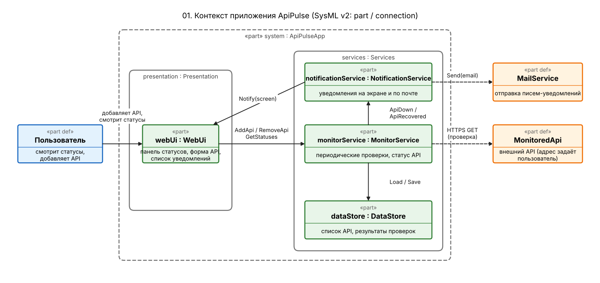
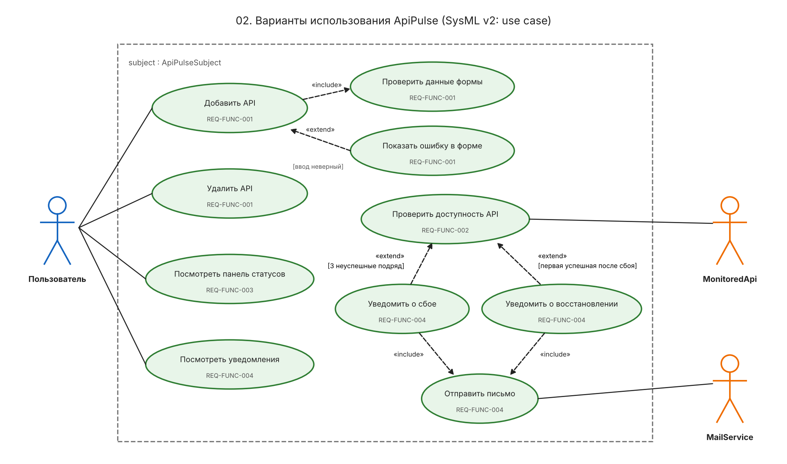
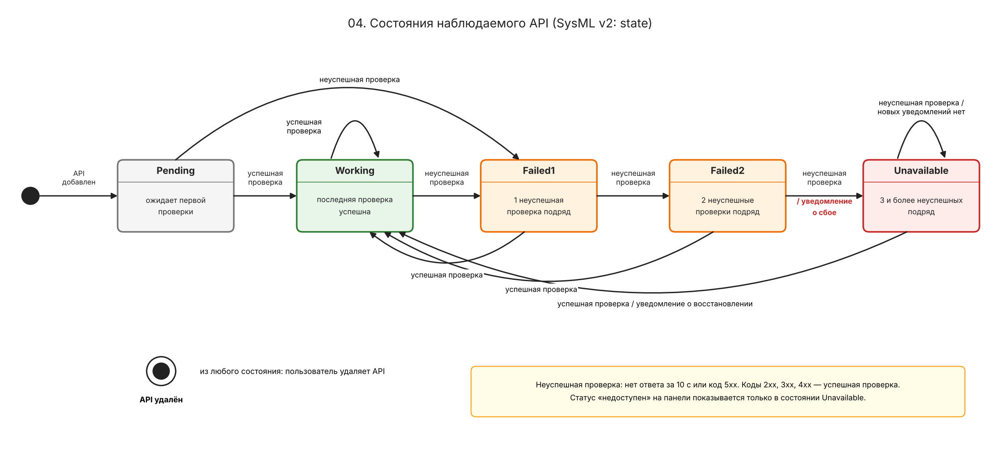
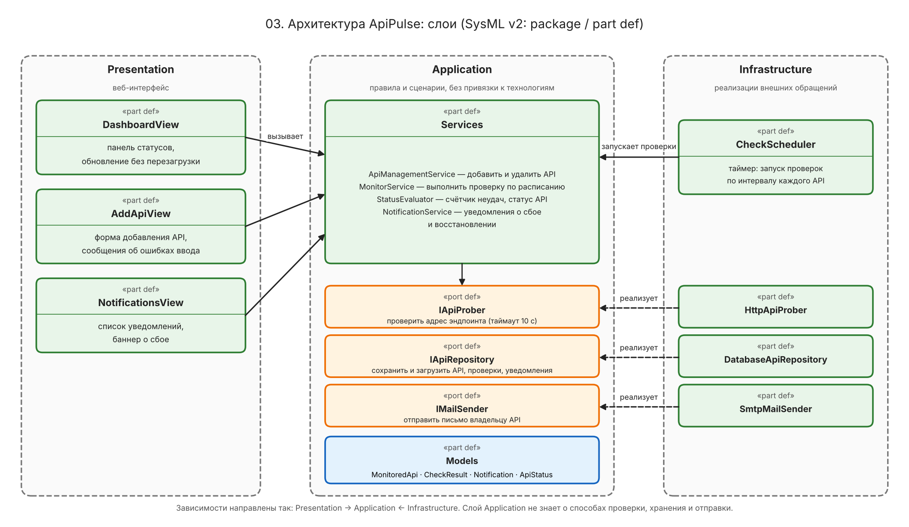

# Спецификация требований к ПО

## Для веб-приложения ApiPulse

Версия 0.4 (черновик)

Подготовил(а) Ледник Я.Ю.

БГУИР, кафедра ЭВМ

2026-11-11

## Оглавление

* [1. Введение](#1-введение)
  * [1.1 Назначение документа](#11-назначение-документа)
  * [1.2 Область применения продукта](#12-область-применения-продукта)
  * [1.3 Определения, акронимы и сокращения](#13-определения-акронимы-и-сокращения)
  * [1.4 Ссылки](#14-ссылки)
  * [1.5 Обзор документа](#15-обзор-документа)
* [2. Обзор продукта](#2-обзор-продукта)
  * [2.1 Перспектива продукта](#21-перспектива-продукта)
  * [2.2 Функции продукта](#22-функции-продукта)
  * [2.3 Ограничения продукта](#23-ограничения-продукта)
  * [2.4 Характеристики пользователей](#24-характеристики-пользователей)
  * [2.5 Допущения и зависимости](#25-допущения-и-зависимости)
  * [2.6 Распределение требований](#26-распределение-требований)
* [3. Требования](#3-требования)
  * [3.1 Внешние интерфейсы](#31-внешние-интерфейсы)
    * [3.1.1 Пользовательские интерфейсы](#311-пользовательские-интерфейсы)
    * [3.1.2 Аппаратные интерфейсы](#312-аппаратные-интерфейсы)
    * [3.1.3 Программные интерфейсы](#313-программные-интерфейсы)
  * [3.2 Функциональные требования](#32-функциональные-требования)
  * [3.3 Качество обслуживания](#33-качество-обслуживания)
    * [3.3.1 Производительность](#331-производительность)
    * [3.3.2 Безопасность](#332-безопасность)
    * [3.3.3 Надёжность](#333-надёжность)
    * [3.3.4 Доступность](#334-доступность)
    * [3.3.5 Наблюдаемость](#335-наблюдаемость)
  * [3.4 Соответствие стандартам](#34-соответствие-стандартам)
  * [3.5 Проектирование и реализация](#35-проектирование-и-реализация)
  * [3.6 ИИ/МО](#36-иимо)
* [4. Верификация](#4-верификация)
* [5. Приложения](#5-приложения)

## История изменений

| Имя | Дата | Причина изменений | Версия |
|-----|------|-------------------|--------|
| Ледник Я.Ю. | 2026-11-04 | Первый черновик: проверка доступности API и уведомление о сбое | 0.1 |
| Ледник Я.Ю. | 2026-11-11 | Приведение к шаблону: поле «Дополнительная информация», оглавление, уточнение формулировок и терминов, разделы 3.3–3.6, резервирование ID под требования по расходам, бюджету и входу | 0.2 |
| Ледник Я.Ю. | 2026-11-11 | Исправление ссылок на шаблон и макеты, согласование статуса REQ-SEC-005 и матрицы верификации; добавлены карточки требований в project-req.md | 0.3 |
| Ледник Я.Ю. | 2026-11-11 | Добавлены диаграммы SysML v2 (контекст, варианты использования, состояния, архитектура), макеты экранов в приложении A и приложение D | 0.4 |

---

## 1. Введение

### 1.1 Назначение документа

Документ описывает бизнес-требования к веб-приложению ApiPulse: что оно должно делать и зачем оно нужно заказчику. Документ предназначен для заказчика (согласование требований), разработчика (реализация) и тестировщика (проверка). Документ определяет **ЧТО** должна делать система, а не **КАК** она будет устроена.

### 1.2 Область применения продукта

**Продукт:** ApiPulse, версия 1.0 (рабочее название).

**Назначение.** Мониторинг доступности внешних API-сервисов и контроль затрат на их использование.

**Бизнес-цели:** будут уточнены с заказчиком.

**Границы версии 1.0 (предварительно):**

* входит: проверка доступности API, учёт расходов и бюджет, уведомления, вход пользователя, журнал расходов, выбор цветовой схемы;
* не входит: оплата счетов поставщикам, управление самими API, автоматический сбор расходов у поставщиков, мобильное приложение.

### 1.3 Определения, акронимы и сокращения

| Термин | Определение |
|--------|-------------|
| Бюджет | Максимальная сумма, которую пользователь готов потратить на API за календарный месяц |
| Журнал расходов | Список внесённых расходов за выбранный месяц или год с разбивкой по дням |
| Запомнить устройство | Опция при входе: пользователь остаётся авторизованным на этом устройстве дольше обычного срока сессии |
| Кэш | Временное хранилище результатов запросов: повторный одинаковый запрос обслуживается без повторной обработки |
| Недоступный API | API, для которого получены три неуспешные проверки подряд; на панели имеет статус «недоступен» |
| Неуспешная проверка | Одна проверка, при которой ответ не получен за 10 секунд либо получен HTTP-код 5xx |
| Порог предупреждения | Доля бюджета в процентах, при достижении которой пользователь получает предупреждение (по умолчанию 80 %) |
| Уведомление на экране | Сообщение в интерфейсе приложения, которое остаётся в списке уведомлений, пока пользователь его не прочитает |
| Хеш пароля | Результат необратимого преобразования пароля: по нему нельзя восстановить пароль, но можно проверить, совпадает ли введённый пароль |
| Шифрование | Обратимое преобразование данных с помощью ключа: без ключа прочитать данные нельзя |
| Эндпоинт | Конкретный адрес API, к которому отправляется запрос |
| API | Application Programming Interface — интерфейс, через который одна программа обращается к другой |
| CSV | Текстовый формат таблицы, в котором значения разделены запятыми |
| HTTP-код | Число в ответе сервера: 200 — успех, 4xx — ошибка запроса, 5xx — ошибка сервера |
| JWT | JSON Web Token — подписанный токен, который сервер выдаёт после входа и по которому узнаёт пользователя в следующих запросах |
| SRS | Software Requirements Specification — спецификация требований к ПО |
| TTL | Time To Live — срок жизни токена или записи кэша, после которого они считаются недействительными |
| UI | User Interface — пользовательский интерфейс |

### 1.4 Ссылки

| № | Название | Владелец | Версия | Дата | Расположение | Тип |
|---|----------|----------|--------|------|--------------|-----|
| 1 | Шаблон SRS курса (ISO/IEC/IEEE 29148:2018) | Курс ЖЦРПО | — | — | [srs/srs-template.md (ветка main)](https://github.com/Shvepster/SDLC/blob/main/srs/srs-template.md) | нормативная |
| 2 | Карточки требований | Ледник Я.Ю. | 0.3 | 2026-11-11 | [project-req.md](./project-req.md) | справочная |
| 3 | Макеты интерфейса | Ледник Я.Ю. | — | 2026-11-11 | [mockup-dashboard.png](./img/mockup-dashboard.png), [mockup-add-api.png](./img/mockup-add-api.png) | справочная |
| 4 | Графические модели SysML v2 (исходники и рисунки) | Ледник Я.Ю. | 0.1 | 2026-11-11 | [srs/img/*.sysml](./img/) | справочная |

### 1.5 Обзор документа

Раздел 2 описывает продукт в целом. Раздел 3 содержит проверяемые требования с идентификаторами вида `REQ-[ОБЛАСТЬ]-[НОМЕР]`; ключевое слово «должна» означает обязательное требование. Раздел 4 — матрица верификации. Раздел 5 — приложения, в том числе список открытых вопросов. Подразделы 3.5 и 3.6 шаблона в этой версии не заполняются (причины указаны в них). История изменений ведётся в начале документа; идентификатор требования не меняется, а при изменении уже согласованного требования к нему добавляется номер версии (`REQ-FUNC-002-2`).

---

## 2. Обзор продукта

### 2.1 Перспектива продукта

ApiPulse — самостоятельное веб-приложение (новый продукт). Работает в браузере пользователя, отправляет HTTP(S)-запросы на адреса API, которые указал пользователь, и отправляет уведомления на электронную почту. Проверяемые API не изменяет.

*Рисунок 1 — контекст приложения (SysML v2: `img/01-context.sysml`). Модель охватывает REQ-FUNC-001…004.*

### 2.2 Функции продукта

* Вход в приложение по почте и паролю; данные одного пользователя не видны другому.
* Добавление и удаление проверяемых API.
* Автоматическая регулярная проверка доступности каждого API.
* Отображение статуса всех API на одной панели.
* Уведомление пользователя о недоступности API и о возобновлении его работы.
* Учёт расходов на API: ручной ввод и загрузка из CSV-файла.
* Месячный бюджет и предупреждения о достижении порога и бюджета.
* Журнал расходов за месяц или год с точностью до дня.
* Выбор цветовой схемы интерфейса.

Подробности по каждой функции — в разделе 3; какое требование к какой функции относится — в таблице 2.6.

Варианты использования функции контроля доступности показаны на рисунке 2.

*Рисунок 2 — варианты использования (SysML v2: `img/02-use-cases.sysml`).*

### 2.3 Ограничения продукта

* Приложение должно работать в последних двух версиях браузеров Chrome, Firefox и Edge.
* Серверная часть должна быть написана на Java.
* Язык интерфейса и документации — русский.

### 2.4 Характеристики пользователей

* **Разработчик:** добавляет API и следит за их состоянием, работает с приложением ежедневно.
* **Руководитель команды:** смотрит общую картину, заходит редко и не обязан разбираться в технических деталях.

Оба класса пользователей входят под своей учётной записью и видят только свои данные.

### 2.5 Допущения и зависимости

| Допущение или зависимость | Что будет, если не выполняется |
|---------------------------|--------------------------------|
| Допущение: проверяемые API доступны из интернета, для проверки достаточно одного HTTP-запроса | API за файрволом или с многошаговой авторизацией проверить нельзя: он всегда будет «недоступен» |
| Зависимость: для отправки писем нужен почтовый сервис | Письма не уходят, уведомления остаются только на экране (REQ-FUNC-004) |
| Допущение: пользователь указывает действующий адрес почты | Письма не доходят, пользователь не получает почтовые уведомления |
| Допущение: CSV-файл соответствует формату, который принимает приложение | Строки с ошибками отклоняются (детали — REQ-FUNC-006) |

### 2.6 Распределение требований

Все описанные и запланированные требования относятся к версии 1.0; REQ-SEC-005 пока предложено. Идентификаторы зарезервированы заранее, чтобы авторы не выбрали один и тот же номер. Состояние «Ожидается» означает, что требование ещё не перенесено в раздел 3; его карточка ведётся в project-req.md.

| ID | Название | Раздел | Кто описывает | Состояние |
|----|----------|--------|---------------|-----------|
| REQ-FUNC-001 | Добавление и удаление проверяемого API | 3.2 | Ледник Я.Ю. | Описано |
| REQ-FUNC-002 | Периодическая проверка доступности | 3.2 | Ледник Я.Ю. | Описано |
| REQ-FUNC-003 | Главная панель статусов | 3.2 | Ледник Я.Ю. | Описано |
| REQ-FUNC-004 | Уведомление о недоступности и восстановлении API | 3.2 | Ледник Я.Ю. | Описано |
| REQ-FUNC-005 | Ручной ввод расходов | 3.2 | Напарник (PR) | Ожидается |
| REQ-FUNC-006 | Загрузка расходов из CSV-файла | 3.2 | Напарник (PR) | Ожидается |
| REQ-FUNC-007 | Месячный бюджет и настройка порога предупреждения | 3.2 | Напарник (PR) | Ожидается |
| REQ-FUNC-008 | Предупреждения о достижении порога и бюджета | 3.2 | Напарник (PR) | Ожидается |
| REQ-FUNC-009 | Журнал расходов за месяц и год | 3.2 | Напарник (PR) | Ожидается |
| REQ-FUNC-010 | Вход по почте и паролю | 3.2 | Напарник (PR) | Ожидается |
| REQ-INT-001 | Выбор цветовой схемы (не менее 10 вариантов) | 3.1.1 | Напарник (PR) | Ожидается |
| REQ-PERF-001 | Кэширование запросов | 3.3.1 | Напарник (PR) | Ожидается |
| REQ-SEC-001 | Изоляция данных пользователей | 3.3.2 | Напарник (PR) | Ожидается |
| REQ-SEC-002 | Хранение паролей только в виде хеша | 3.3.2 | Напарник (PR) | Ожидается |
| REQ-SEC-003 | Хранение ключей доступа к API в зашифрованном виде | 3.3.2 | Напарник (PR) | Ожидается |
| REQ-SEC-004 | Токены JWT: срок жизни и «запомнить устройство» | 3.3.2 | Напарник (PR) | Ожидается |
| REQ-SEC-005 | Запрет проверки адресов внутренних сетей (предложено, см. вопрос C9) | 3.3.2 | Не назначен | Предложено |

---

## 3. Требования

### 3.1 Внешние интерфейсы

#### 3.1.1 Пользовательские интерфейсы

Экраны приложения приведены на макетах (приложение A). Состав экранов версии 1.0: вход; главная панель статусов; форма добавления API; список уведомлений; расходы и бюджет; журнал расходов; настройки (цветовая схема).

#### 3.1.2 Аппаратные интерфейсы

Не применимо: приложение работает в браузере и не обращается к устройствам напрямую.

#### 3.1.3 Программные интерфейсы

* **Проверяемые API.** Система отправляет HTTP(S)-запрос на адрес эндпоинта и оценивает ответ по HTTP-коду и времени ответа. Владелец API — внешний поставщик, система его данные не изменяет.
* **Почтовый сервис.** Система передаёт ему письма-уведомления. Конкретный сервис выбирается при проектировании. Поведение при его недоступности описано в REQ-FUNC-004.

### 3.2 Функциональные требования

Правило «недоступен после трёх неуспешных проверок подряд» (REQ-FUNC-002, REQ-FUNC-003, REQ-FUNC-004) показано на диаграмме состояний одного API.

*Рисунок 3 — состояния наблюдаемого API (SysML v2: `img/04-states.sysml`).*

* **ID:** REQ-FUNC-001
* **Название:** Добавление и удаление проверяемого API
* **Формулировка:** Система должна позволять пользователю добавить API, указав название, адрес эндпоинта, интервал проверки и (необязательно) ключ доступа к API, а также удалить ранее добавленный API.
* **Обоснование:** Без списка API нечего проверять. Ключ доступа нужен для API, которые отвечают только авторизованным запросам.
* **Критерии приёмки:**
  * После сохранения API появляется на главной панели.
  * Пустое название отклоняется; сообщение указывает на поле «Название» (например, «Введите название API»).
  * Адрес, который не является корректным адресом HTTP или HTTPS (например, не начинается с `http://` или `https://`), отклоняется; сообщение указывает на поле «Адрес».
  * Ключ доступа можно не указывать; если он указан, система использует его при проверках этого API.
  * После удаления API исчезает с панели, его проверки прекращаются.
* **Метод верификации:** Основной: Тест (TC-FUNC-001).
* **Дополнительная информация:** Допустимый интервал и его значение по умолчанию — в REQ-FUNC-002. Хранение ключа — REQ-SEC-003. Принадлежность API пользователю — REQ-SEC-001. Что происходит с расходами при удалении API, не решено (вопрос C3). Как ключ передаётся в запросе, не решено (вопрос C1). Макет: приложение A.

* **ID:** REQ-FUNC-002
* **Название:** Периодическая проверка доступности
* **Формулировка:** Система должна автоматически проверять каждый добавленный API с интервалом, заданным пользователем, от 1 до 60 минут (по умолчанию 5 минут), и определять результат каждой проверки: проверка неуспешна, если ответ не получен за 10 секунд либо получен HTTP-код 5xx; в остальных случаях проверка успешна.
* **Обоснование:** Заказчик хочет узнавать о сбое раньше своих клиентов.
* **Критерии приёмки:**
  * Следующая проверка начинается через заданный интервал после предыдущей с отклонением не более 10 секунд.
  * Интервал задаётся целым числом минут; значения 1 и 60 принимаются, значения 0 и 61 отклоняются с сообщением о допустимом диапазоне.
  * Если интервал не указан, используется 5 минут.
  * Эндпоинт, ответивший кодом 5xx, даёт неуспешную проверку.
  * Эндпоинт, не ответивший за 10 секунд, даёт неуспешную проверку.
  * Ответ с кодом 2xx, 3xx или 4xx даёт успешную проверку (переходы по редиректам не выполняются).
  * Результат и время ответа каждой проверки сохраняются для показа на панели.
* **Метод верификации:** Основной: Тест (TC-FUNC-002).
* **Дополнительная информация:** Недоступным API становится не после одной неуспешной проверки, а после трёх подряд (REQ-FUNC-003, REQ-FUNC-004). Код 4xx считается успешным ответом, значит неверный ключ доступа (401, 403) сбоем не считается (вопрос C2). Время 10 секунд фиксировано и пользователем не настраивается.

* **ID:** REQ-FUNC-003
* **Название:** Главная панель статусов
* **Формулировка:** Система должна отображать на главной панели для каждого API текущий статус («работает» / «недоступен»), время последней проверки и время ответа.
* **Обоснование:** Состояние всех сервисов должно быть видно с одного экрана.
* **Критерии приёмки:**
  * После одной или двух неуспешных проверок подряд статус остаётся «работает»; после третьей неуспешной подряд становится «недоступен».
  * После первой успешной проверки статус недоступного API становится «работает».
  * Время последней проверки и время ответа соответствуют последней проверке; если ответ не получен, время ответа отображается как «нет ответа».
  * Новый результат проверки появляется на панели без перезагрузки страницы не позднее чем через 30 секунд.
* **Метод верификации:** Основной: Тест (TC-FUNC-003).
* **Дополнительная информация:** Панель показывает только API текущего пользователя (REQ-SEC-001). Кэширование (REQ-PERF-001) не должно приводить к показу устаревшего статуса (вопрос C8). Макет: приложение A.

* **ID:** REQ-FUNC-004
* **Название:** Уведомление о недоступности и восстановлении API
* **Формулировка:** Система должна уведомлять пользователя на экране и по электронной почте о недоступности API после трёх неуспешных проверок подряд, не позднее чем через одну минуту после третьей, а также о возобновлении работы API.
* **Обоснование:** Три проверки подряд защищают от ложных тревог из-за кратковременных сбоев сети.
* **Критерии приёмки:**
  * После двух неуспешных проверок подряд уведомления нет.
  * После третьей неуспешной проверки подряд создаётся ровно одно уведомление на экране и отправляется ровно одно письмо, не позднее чем через одну минуту после этой проверки.
  * Пока API остаётся недоступным, новые уведомления об этом сбое не создаются.
  * После первой успешной проверки недоступного API создаётся уведомление о возобновлении работы (на экране и по почте).
  * Если API после восстановления снова получил три неуспешные проверки подряд, создаётся новое уведомление о недоступности.
  * Письмо отправляется на адрес электронной почты владельца API, указанный при входе (REQ-FUNC-010).
  * Если почтовый сервис недоступен, уведомление остаётся на экране.
* **Метод верификации:** Основной: Тест (TC-FUNC-004). Вторичный: Демонстрация сквозного сценария на тестовом эндпоинте для заказчика.
* **Дополнительная информация:** Время от начала сбоя до уведомления составляет примерно (3 − 1) × интервал + время проверки; при интервале 60 минут это больше двух часов. Это принято осознанно: короткий интервал выбирает сам пользователь. Тот же механизм уведомлений на экране используется для предупреждений о бюджете (REQ-FUNC-008). Зависимость: почтовый сервис (раздел 2.5).

<!-- Новые функциональные требования добавлять ниже, начиная с REQ-FUNC-005 (см. таблицу 2.6) -->

### 3.3 Качество обслуживания

#### 3.3.1 Производительность

Ожидается: REQ-PERF-001 (кэширование запросов).

#### 3.3.2 Безопасность

Ожидается: REQ-SEC-001…REQ-SEC-004; REQ-SEC-005 — предложено (см. таблицу 2.6).

#### 3.3.3 Надёжность

Требования не определены в версии 0.4 и будут уточнены с заказчиком.

#### 3.3.4 Доступность

Требования не определены в версии 0.4 и будут уточнены с заказчиком.

#### 3.3.5 Наблюдаемость

Требования не определены в версии 0.4 и будут уточнены с заказчиком.

### 3.4 Соответствие стандартам

Требования не определены в версии 0.4 и будут уточнены с заказчиком.

### 3.5 Проектирование и реализация

Не применимо к этой версии: документ описывает бизнес-требования, а ограничения реализации приведены в разделе 2.3. Подразделы шаблона 3.5.1–3.5.10 (установка, сборка и поставка, распределение, сопровождаемость, повторное использование, переносимость, стоимость, сроки, доказательство концепции, управление изменениями) не заполняются.

### 3.6 ИИ/МО

Не применимо: в продукте нет компонентов искусственного интеллекта и машинного обучения.

---

## 4. Верификация

Тест-кейсы планируется хранить в папке `tests/`; в текущей версии документы тест-кейсов ещё не добавлены. Имя файла должно совпадать с ID тест-кейса (`TC-FUNC-001` для `REQ-FUNC-001`). Для требований, которые ещё не описаны, метод выберет автор карточки.

| ID требования | Метод | Артефакт проверки | Статус | Доказательства |
|---------------|-------|-------------------|--------|----------------|
| REQ-FUNC-001 | Тест | TC-FUNC-001 | Запланировано | |
| REQ-FUNC-002 | Тест | TC-FUNC-002 | Запланировано | |
| REQ-FUNC-003 | Тест | TC-FUNC-003 | Запланировано | |
| REQ-FUNC-004 | Тест, Демонстрация | TC-FUNC-004, демонстрационный сценарий | Запланировано | |
| REQ-FUNC-005 | — | TC-FUNC-005 | Запланировано | |
| REQ-FUNC-006 | — | TC-FUNC-006 | Запланировано | |
| REQ-FUNC-007 | — | TC-FUNC-007 | Запланировано | |
| REQ-FUNC-008 | — | TC-FUNC-008 | Запланировано | |
| REQ-FUNC-009 | — | TC-FUNC-009 | Запланировано | |
| REQ-FUNC-010 | — | TC-FUNC-010 | Запланировано | |
| REQ-INT-001 | — | TC-INT-001 | Запланировано | |
| REQ-PERF-001 | — | TC-PERF-001 | Запланировано | |
| REQ-SEC-001 | — | TC-SEC-001 | Запланировано | |
| REQ-SEC-002 | — | TC-SEC-002 | Запланировано | |
| REQ-SEC-003 | — | TC-SEC-003 | Запланировано | |
| REQ-SEC-004 | — | TC-SEC-004 | Запланировано | |
| REQ-SEC-005 | — | TC-SEC-005 | Запланировано | |

## 5. Приложения

* **Приложение A:** Макеты интерфейса: [главная панель](./img/mockup-dashboard.png), [форма добавления API](./img/mockup-add-api.png).
* **Приложение B:** Карточки требований: [project-req.md](./project-req.md).
* **Приложение C:** Открытые вопросы.
* **Приложение D:** Графические модели SysML v2.

### Приложение A. Макеты интерфейса

Макеты показывают предполагаемый вид экранов; значения на них приведены для иллюстрации. Описание содержания экранов в SysML v2 — `img/05-ui-mockups.sysml`.

*Рисунок 4 — главная панель (REQ-FUNC-003, REQ-FUNC-004).*

*Рисунок 5 — форма добавления API (REQ-FUNC-001).*

### Приложение C. Открытые вопросы

Пока вопрос не закрыт, в карточках действует предложение по умолчанию.

| № | Вопрос | Затрагивает | Предложение по умолчанию |
|---|--------|-------------|--------------------------|
| C1 | Как передаётся ключ доступа при проверке | REQ-FUNC-001, REQ-SEC-003 | В HTTP-заголовке, имя заголовка указывает пользователь |
| C2 | Считать ли коды 4xx (в том числе 401 и 403) сбоем | REQ-FUNC-002 | Нет: сбой только при таймауте и 5xx |
| C3 | Что будет с расходами при удалении API | REQ-FUNC-001, REQ-FUNC-005, REQ-FUNC-009 | Расходы остаются в журнале с названием удалённого API |
| C4 | В какой валюте вносятся расходы и задаётся бюджет | REQ-FUNC-005…008 | Одна валюта на всё приложение (какая — уточнить у заказчика) |
| C5 | Что такое «месяц» для бюджета и в каком часовом поясе; что при смене бюджета или порога в середине месяца | REQ-FUNC-007, REQ-FUNC-008 | Календарный месяц; остальное решает автор карточек |
| C6 | Формат CSV: разделитель, кодировка, столбцы, предельный размер; что делать со строкой с ошибкой | REQ-FUNC-006 | Решает автор карточки |
| C7 | Как создаётся учётная запись: регистрация, подтверждение почты, восстановление пароля | REQ-FUNC-010 | Самостоятельная регистрация; подтверждение почты и восстановление пароля вне версии 1.0 |
| C8 | Что именно кэшируется | REQ-PERF-001, REQ-FUNC-003 | Данные панели и журнала; проверки доступности и вход не кэшируются; данные разных пользователей не смешиваются |
| C9 | Можно ли указывать адреса внутренних сетей (`localhost`, `192.168.x.x`) | REQ-FUNC-001, REQ-SEC-005 | Нет, такие адреса отклоняются |
| C10 | Значения срока жизни токена и режима «запомнить устройство» | REQ-SEC-004 | 60 минут и 30 дней |

### Приложение D. Графические модели SysML v2

Каждая диаграмма описана текстом на SysML v2 (файл `.sysml`); рисунки подготовлены по этим моделям. Модели охватывают функцию контроля доступности (REQ-FUNC-001…004).

| Рисунок | Назначение | Рисунок (PNG) | Исходная модель |
|---------|------------|---------------|-----------------|
| 1 | Контекст приложения | `img/01-context.png` | `img/01-context.sysml` |
| 2 | Варианты использования | `img/02-use-cases.png` | `img/02-use-cases.sysml` |
| 3 | Состояния наблюдаемого API | `img/04-states.png` | `img/04-states.sysml` |
| 4, 5 | Макеты экранов | `img/mockup-dashboard.png`, `img/mockup-add-api.png` | `img/05-ui-mockups.sysml` |
| 6 | Слои приложения (справочная схема) | `img/03-architecture.png` | `img/03-architecture.sysml` |

Схема слоёв (рисунок 6) показывает один из возможных вариантов построения и **не является требованием**: выбор архитектуры относится к проектированию.

*Рисунок 6 — слои приложения (SysML v2: `img/03-architecture.sysml`).*